# Editing with HMA-CE: screenshots

What the mod's data looks like in Hex Maniac Advance CE with the build's `.toml`. Setting it up, and the list of
anchors, is in the README's [Editing with Hex Maniac Advance](README.md#editing-with-hex-maniac-advance) (use HMA CE
built from source, `upcoming` branch). [README_TODO.md](README_TODO.md) says what each picture should show.

   
  The build's <code>.toml</code>: every anchor, and what it holds

## The patched ROM in HMA

<table>
<tr>
<td align="center">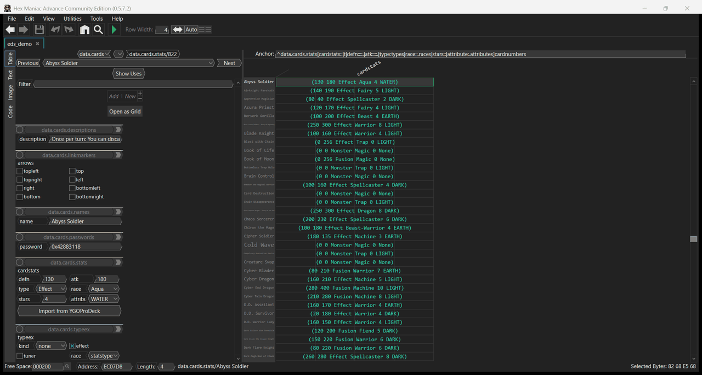 HMA with the TOML</td>
<td align="center">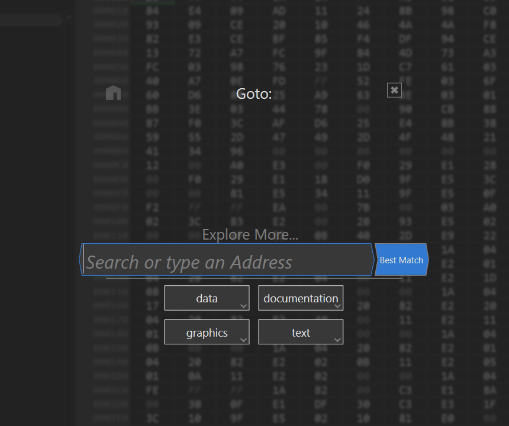 HMA: the anchors in Goto</td>
</tr>
</table>

## Formats, decks and recipes

<table>
<tr>
<td align="center">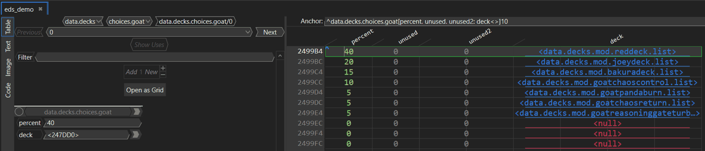 A format's deck chances</td>
<td align="center">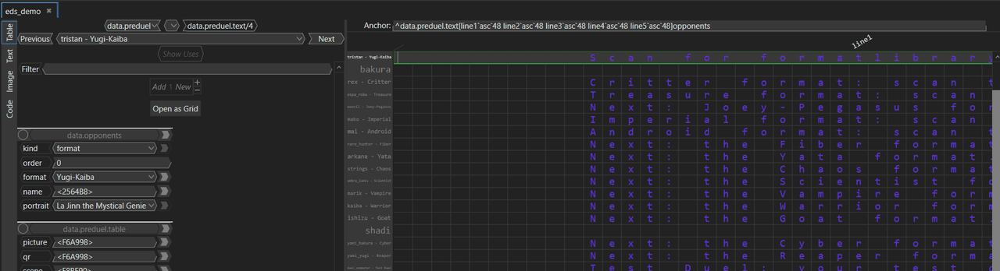 The premade Deck Recipes</td>
<td align="center">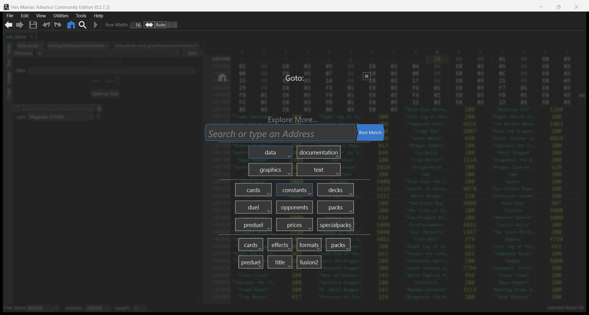 The unlock wins</td>
</tr>
</table>

## Prices and packs

<table>
<tr>
<td align="center">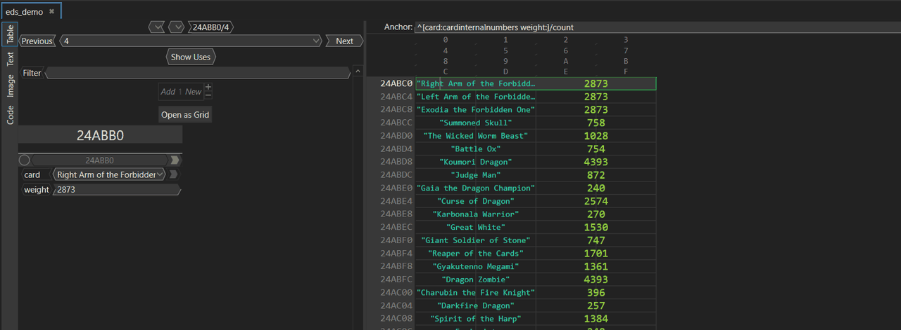 A format's card prices</td>
<td align="center">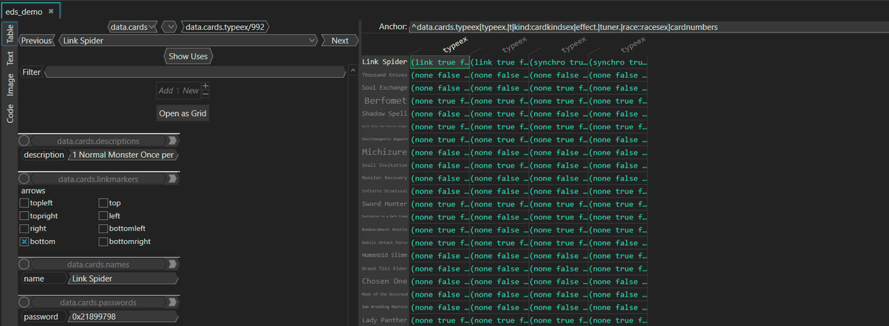 A pack's cards and weights</td>
<td align="center">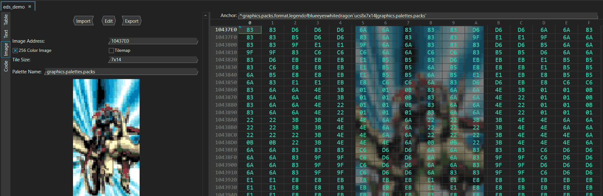 Pack names and covers</td>
</tr>
</table>

## The added cards

<table>
<tr>
<td align="center">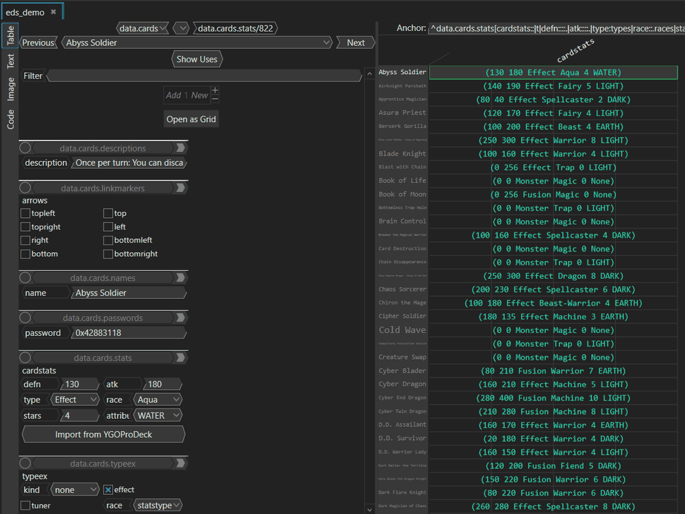 The added cards' stats</td>
<td align="center">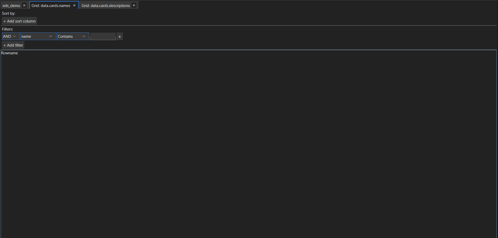 Card names and text</td>
<td align="center">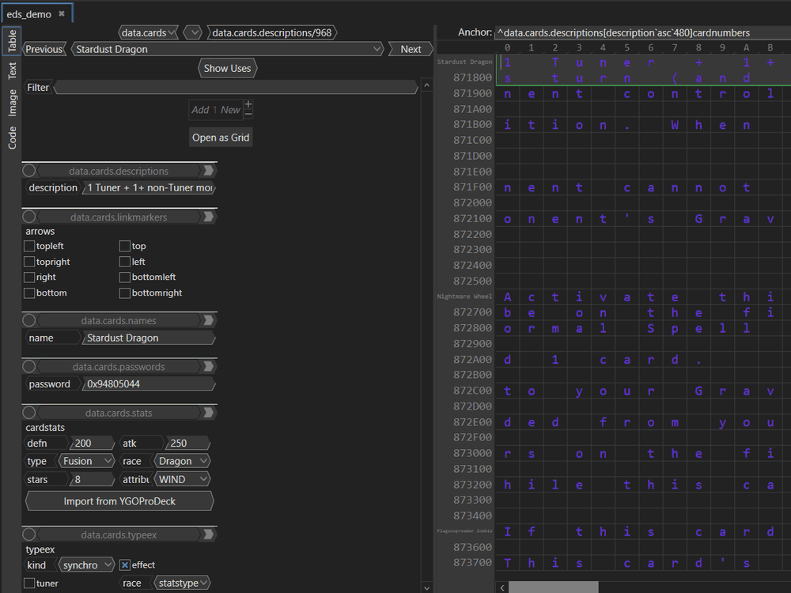 Link Arrows</td>
</tr>
</table>

HMA-CE can also fill in a card's stats and art from YGOProDeck: **Import from YGOProDeck**.

  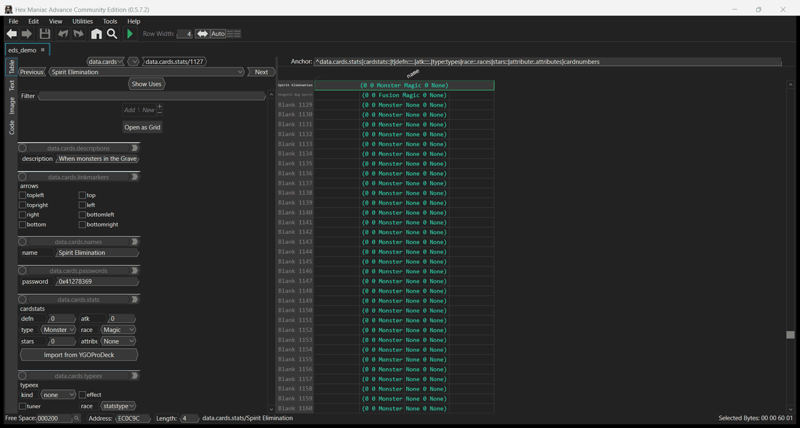 
  Import from YGOProDeck (GIF)

## Opponents and their decks

<table>
<tr>
<td align="center">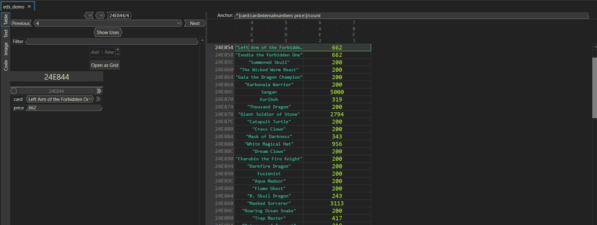 The opponents table</td>
<td align="center">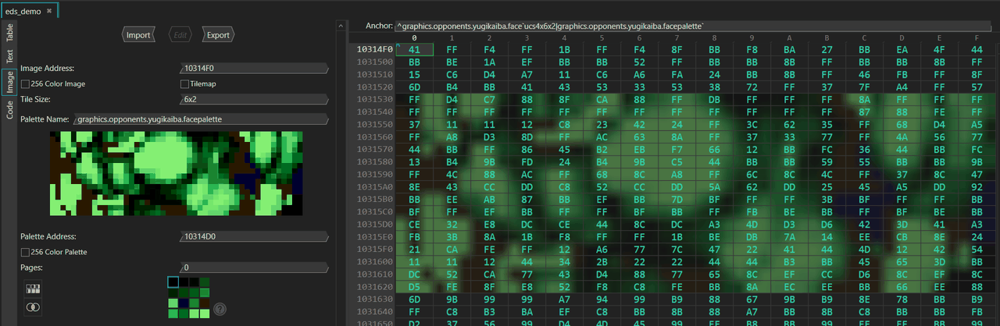.face) in HMA's Image tool"> An opponent's portrait</td>
<td align="center">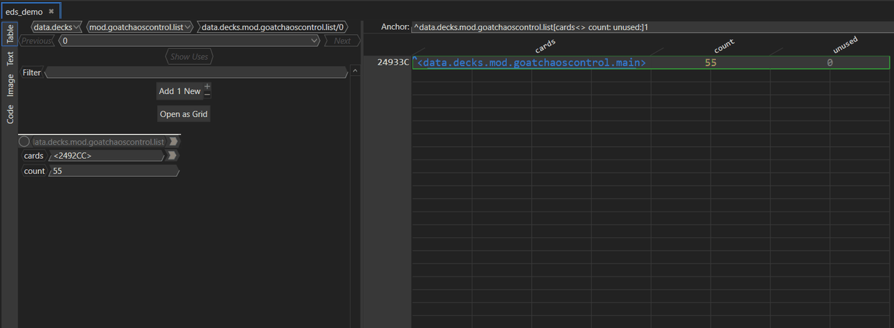 An opponent's deck</td>
</tr>
</table>

HMA-CE can also fill a deck table from a `.ydk` deck file: **Import .YDK**.

  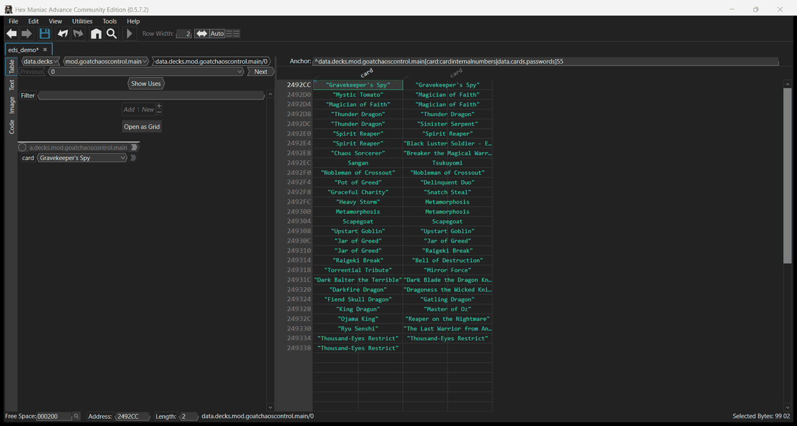 
  Import .YDK (GIF)

## Screens and art

<table>
<tr>
<td align="center">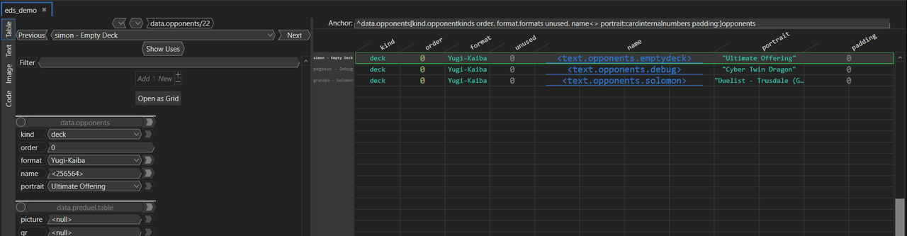 Pre-duel text</td>
<td align="center">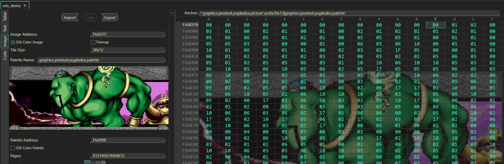.picture) in HMA's Image tool"> A pre-duel picture</td>
<td align="center">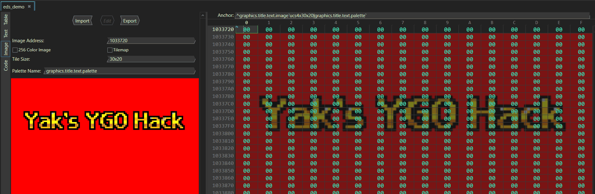 The title screen</td>
</tr>
<tr>
<td align="center">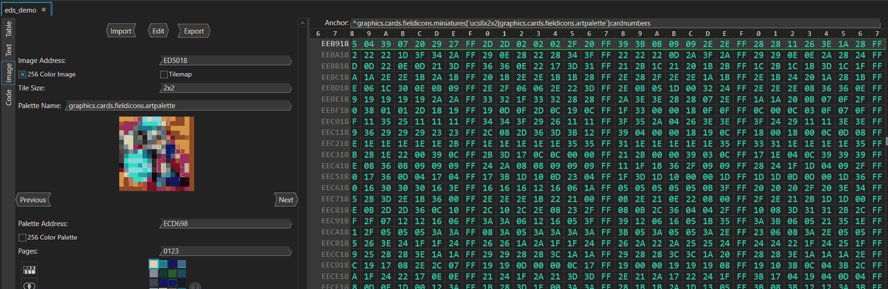 In-duel card art</td>
<td align="center">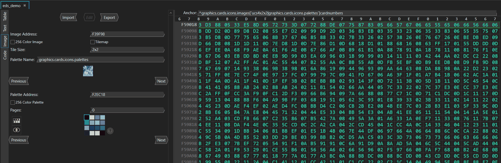 Deck Edit ring art</td>
</tr>
</table>
