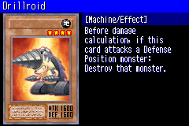
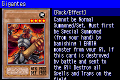
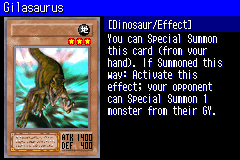
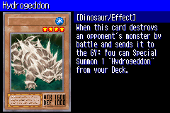
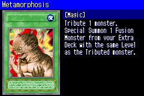
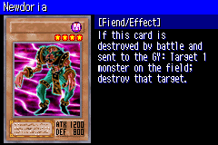
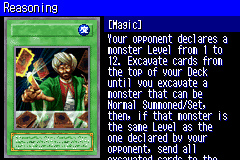
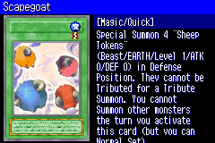
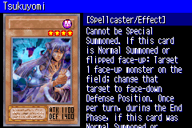
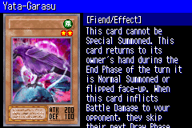

# New cards

The 135 cards added in the demo card list (the repo-root `new_cards.txt`, above `------`), as the game shows them in Deck Edit's Card View. The screenshots are taken by [`tools/card_screenshots.lua`](tools/card_screenshots.lua) in mGBA.

<table>
<tr>
<td align="center"> 4-Starred Ladybug of Doom</td>
<td align="center"> Abyss Soldier</td>
<td align="center"> Airknight Parshath</td>
<td align="center"> Apprentice Magician</td>
</tr>
<tr>
<td align="center"> Asura Priest</td>
<td align="center"> Bazoo the Soul-Eater</td>
<td align="center"> Berserk Gorilla</td>
<td align="center"> Black Luster Soldier - Envoy of the Beginning</td>
</tr>
<tr>
<td align="center"> Blade Knight</td>
<td align="center"> Blast with Chain</td>
<td align="center"> Book of Life</td>
<td align="center"> Book of Moon</td>
</tr>
<tr>
<td align="center"> Bottomless Trap Hole</td>
<td align="center"> Brain Control</td>
<td align="center"> Breaker the Magical Warrior</td>
<td align="center"> Card Destruction</td>
</tr>
<tr>
<td align="center"> Chain Disappearance</td>
<td align="center"> Chaos Emperor Dragon - Envoy of the End</td>
<td align="center"> Chaos Sorcerer</td>
<td align="center"> Chiron the Mage</td>
</tr>
<tr>
<td align="center"> Cipher Soldier</td>
<td align="center"> Cold Wave</td>
<td align="center"> Compulsory Evacuation Device</td>
<td align="center"> Creature Swap</td>
</tr>
<tr>
<td align="center"> Cyber Dragon</td>
<td align="center"> Cyber End Dragon</td>
<td align="center"> Cyber Twin Dragon</td>
<td align="center"> D.D. Assailant</td>
</tr>
<tr>
<td align="center"> D.D. Survivor</td>
<td align="center"> D.D. Warrior Lady</td>
<td align="center"> Dark Magician of Chaos</td>
<td align="center"> Dark Mimic LV1</td>
</tr>
<tr>
<td align="center"> Dark Ruler Ha Des</td>
<td align="center"> Dark Scorpion - Cliff the Trap Remover</td>
<td align="center"> Dekoichi the Battlechanted Locomotive</td>
<td align="center"> Des Koala</td>
</tr>
<tr>
<td align="center"> Different Dimension Capsule</td>
<td align="center"> Dimension Fusion</td>
<td align="center"> Don Zaloog</td>
<td align="center"> Drillroid</td>
</tr>
<tr>
<td align="center"> Emergency Provisions</td>
<td align="center"> Enemy Controller</td>
<td align="center"> Exarion Universe</td>
<td align="center"> Exiled Force</td>
</tr>
<tr>
<td align="center"> Fairy Box</td>
<td align="center"> Fiber Jar</td>
<td align="center"> Final Attack Orders</td>
<td align="center"> Gearfried the Iron Knight</td>
</tr>
<tr>
<td align="center"> Gigantes</td>
<td align="center"> Gilasaurus</td>
<td align="center"> Goblin Attack Force</td>
<td align="center"> Goblin Elite Attack Force</td>
</tr>
<tr>
<td align="center"> Golem Sentry</td>
<td align="center"> Gravekeeper's Spy</td>
<td align="center"> Gravity Bind</td>
<td align="center"> Guardian Sphinx</td>
</tr>
<tr>
<td align="center"> Gyaku-Gire Panda</td>
<td align="center"> Hallowed Life Barrier</td>
<td align="center"> Hydrogeddon</td>
<td align="center"> Hysteric Fairy</td>
</tr>
<tr>
<td align="center"> Injection Fairy Lily</td>
<td align="center"> Jar of Greed</td>
<td align="center"> King Tiger Wanghu</td>
<td align="center"> Kycoo the Ghost Destroyer</td>
</tr>
<tr>
<td align="center"> Level Limit - Area B</td>
<td align="center"> Lightning Vortex</td>
<td align="center"> Mage Power</td>
<td align="center"> Magic Cylinder</td>
</tr>
<tr>
<td align="center"> Magic Drain</td>
<td align="center"> Magical Merchant</td>
<td align="center"> Magical Scientist</td>
<td align="center"> Manticore of Darkness</td>
</tr>
<tr>
<td align="center"> Marauding Captain</td>
<td align="center"> Masked Dragon</td>
<td align="center"> Metamorphosis</td>
<td align="center"> Mind Control</td>
</tr>
<tr>
<td align="center"> Mirage of Nightmare</td>
<td align="center"> Mobius the Frost Monarch</td>
<td align="center"> Monster Gate</td>
<td align="center"> Monster Reincarnation</td>
</tr>
<tr>
<td align="center"> Mystic Swordsman LV2</td>
<td align="center"> Mystik Wok</td>
<td align="center"> Newdoria</td>
<td align="center"> Night Assailant</td>
</tr>
<tr>
<td align="center"> Ninja Grandmaster Sasuke</td>
<td align="center"> Ojama Token</td>
<td align="center"> Ojama Trio</td>
<td align="center"> Phoenix Wing Wind Blast</td>
</tr>
<tr>
<td align="center"> Pikeru's Circle of Enchantment</td>
<td align="center"> Poison of the Old Man</td>
<td align="center"> Pot of Avarice</td>
<td align="center"> Pyramid Turtle</td>
</tr>
<tr>
<td align="center"> Raigeki Break</td>
<td align="center"> Reasoning</td>
<td align="center"> Reinforcement of the Army</td>
<td align="center"> Return from the Different Dimension</td>
</tr>
<tr>
<td align="center"> Roulette Barrel</td>
<td align="center"> Royal Oppression</td>
<td align="center"> Ryu Kokki</td>
<td align="center"> Sacred Crane</td>
</tr>
<tr>
<td align="center"> Sakuretsu Armor</td>
<td align="center"> Sand Moth</td>
<td align="center"> Sasuke Samurai</td>
<td align="center"> Scapegoat</td>
</tr>
<tr>
<td align="center"> Secret Barrel</td>
<td align="center"> Sheep Token</td>
<td align="center"> Skilled Dark Magician</td>
<td align="center"> Skull Lair</td>
</tr>
<tr>
<td align="center"> Smashing Ground</td>
<td align="center"> Solemn Wishes</td>
<td align="center"> Soul Exchange</td>
<td align="center"> Spear Dragon</td>
</tr>
<tr>
<td align="center"> Spell Canceller</td>
<td align="center"> Spirit Reaper</td>
<td align="center"> Stealth Bird</td>
<td align="center"> The Fiend Megacyber</td>
</tr>
<tr>
<td align="center"> Thestalos the Firestorm Monarch</td>
<td align="center"> Thousand-Eyes Idol</td>
<td align="center"> Thousand-Eyes Restrict</td>
<td align="center"> Threatening Roar</td>
</tr>
<tr>
<td align="center"> Thunder Nyan Nyan</td>
<td align="center"> Token Thanksgiving</td>
<td align="center"> Toon Cannon Soldier</td>
<td align="center"> Toon Table of Contents</td>
</tr>
<tr>
<td align="center"> Torrential Tribute</td>
<td align="center"> Trap Dustshoot</td>
<td align="center"> Treeborn Frog</td>
<td align="center"> Tribe-Infecting Virus</td>
</tr>
<tr>
<td align="center"> Tsukuyomi</td>
<td align="center"> United We Stand</td>
<td align="center"> Wave-Motion Cannon</td>
<td align="center"> Xing Zhen Hu</td>
</tr>
<tr>
<td align="center"> Yata-Garasu</td>
<td align="center"> Zaborg the Thunder Monarch</td>
<td align="center"> Zombyra the Dark</td>
</tr>
</table>
