# Yak's YGO Hack

<p align="center">
  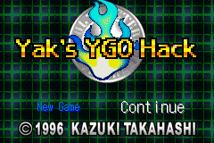
  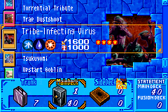
  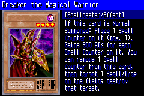
  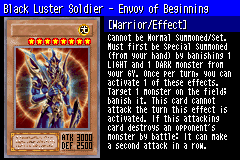
</p>
<p align="center">
  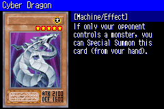
  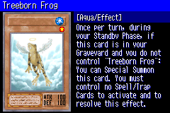
  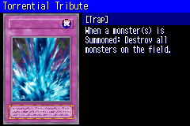
  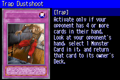
</p>
<p align="center">
  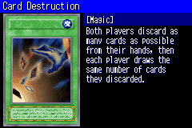
  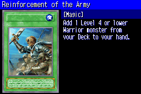
  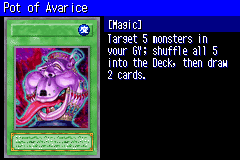
  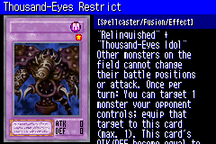
</p>
<p align="center">
  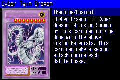
  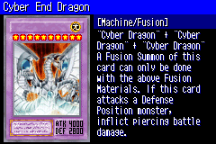
  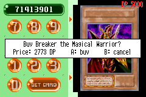
  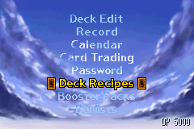
</p>
<p align="center">
  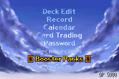
  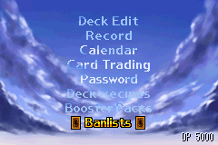
  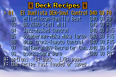
  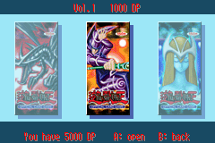
</p>
<p align="center">
  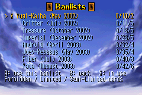
  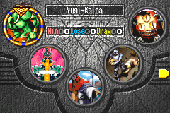
  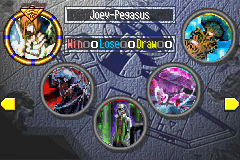
  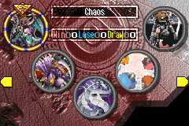
</p>
<p align="center">
  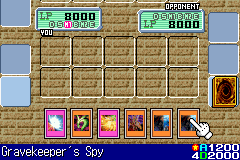
  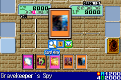
  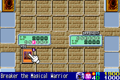
</p>

A hack of *Yu-Gi-Oh! The Eternal Duelist Soul* (GBA) that follows the
[Format Library](https://www.formatlibrary.com/) pantheon of TCG formats, from Yugi-Kaiba up to Reaper. About 100
Goat-era cards have been added so far, with roughly 50 more planned.

## The formats

Each format is a Campaign "duelist". You start with Yugi-Kaiba only; beating a format **10 times** unlocks the
next one.

| # | Format | Banlist |
|---|---|---|
| 1 | Yugi-Kaiba | May 2002 |
| 2 | Critter | July 2002 |
| 3 | Treasure | October 2002 |
| 4 | Imperial | December 2002 |
| 5 | Android | April 2003 |
| 6 | Joey-Pegasus | May 2003 |
| 7 | Fiber | July 2003 |
| 8 | Yata | August 2003 |
| 9 | Scientist | November 2003 |
| 10 | Vampire | February 2004 |
| 11 | Chaos | April 2004 |
| 12 | Warrior | October 2004 |
| 13 | Goat | April 2005 |
| 14 | Cyber | April 2005 |
| 15 | Reaper | October 2005 |

- **Decks.** Each format duelist picks one of 2-3 (sometimes more) strong decks from its format, at weighted
  random. The first 8 duelists are fully coded. [DECKS.md](DECKS.md) lists every deck and its chance.
- **Your deck.** It has to be legal in that format's banlist and card pool to duel them.
- **Portraits.** Each duelist's portrait is its format's namesake card (or the Format Library picture when the
  format isn't named after a card).
- **No dialogue.** Duelists don't talk before or after a duel.
- **Event challengers.** On calendar event days (Championship, Duel Ceremony, Grandpa Cup, Rare Hunter), the
  challenger is drawn from the formats you've unlocked whose banlist your cards can make a 40-card deck under, with
  its original portrait and event dialogue. After the dialogue, your banlist switches to the challenger's format and
  the Deck Recipes screen opens: load a recipe, press SELECT for Deck Edit, or B to duel. In the release, a deck that
  isn't legal in the format (or is under 40 cards) can't duel until you fix it.
- **Deck Recipes.** Up to 50 saved decks, about 25 of them preset to staple decks of the first eight formats and
  Goat. Loading a recipe takes the cards from your trunk; any you don't have are left out (the game tells you which,
  and why). The starting decks and the format presets come with the Side and Extra Decks of their .ydk files. The
  deck recipes will eventually include all 15 TCG formats.
- **Banlists** (main menu). Choose the banlist your deck is built under. Cards your current deck can no longer hold
  go back to the trunk. Before switching, the game checks that your cards can still make a Main Deck of at least
  40 cards under the new banlist (counting its limits and card pool); if they can't, the switch is refused.
- **Duelist Points (DP).**
  - You start with 5000 DP and earn more by winning duels.
  - The card password machine now sells cards: it shows the price and asks before buying.
  - Prices run from 5 to 3000 DP, depending on how much the card is played in the furthest format you've unlocked.
  Cards not in the current furthest format you've unlocked are priced at 3000 DP. [CARD_PRICES.md](CARD_PRICES.md) lists each format's prices.
- **Booster Packs** (main menu). Open any unlocked pack for 1000 DP each for now; prices will change in the release.
  Packs will cover the TCG/OCG sets up to Reaper/Victory format, plus attribute/race/Spell/Trap packs once there are
  enough cards.
- **Card art in duels.** Face-up cards show a small picture of their artwork inside their icon: on the field
  (monsters, Spells/Traps, the Field zone, the top card of each Graveyard and banished pile), in your hand, in the
  card menu, in the chain list, when reordering cards, and while cards move, flip or change position. Deck Edit's
  column of cards beside the list shows each card's art too.
- **Still backgrounds.** The field background no longer scrolls during duels, and the title screen's background
  no longer scrolls either.
- **Fixes.** Deck Edit no longer blots out the first letters of the row above the cursor after Card View (a
  bug in the original game).
- **Best-of-3 matches.** Every Campaign duel against the CPU is a best-of-3 match, not only on match days.
  Between games you can side, swapping cards between your Main Deck and Side Deck. Your deck goes back to how it
  was once the match ends. The CPU uses the same deck for every game of the match. Records, DP and the pack
  reward count the match, not each game.
- **Smarter CPU.**
  - **Battle and positions.**
    - It switches a monster that can't beat any of yours to Defense Position when you have a face-up monster with
      higher ATK, instead of leaving it to be run over. A monster with 1700 ATK or more stays in Attack Position
      unless your strongest monster has at least 1000 more ATK than it.
    - When it chooses Attack or Defense Position, it counts the ATK a monster will gain from an Equip Spell in its
      hand, Breaker's Spell Counter, and Blade Knight's bonus once its hand shrinks.
    - When you control no monsters, it summons a monster with 1700 or more ATK in Attack Position instead of
      Setting it (unless the monster has a flip effect), even on the first turn.
    - It crashes into your monsters with equal ATK when it has no better attack, unless another of its monsters
      can beat yours outright.
    - It Tribute Summons a stronger monster over weaker ones even when the swap doesn't change its attacks, such
      as Gyakutenno Megami (1800/2000) over Aqua Madoor (1200/2000), as long as the summon has more ATK and at
      least as much DEF as each monster it Tributes.
    - It never Tributes a copy of the monster it is summoning, for a Tribute Summon or a Toon's Special Summon,
      unless that monster has an effect that triggers on its summon (Zaborg, Mobius, Breaker, ...).
  - **Card use.**
    - It plays its Spells after its Normal Summon, in both Main Phases. The original CPU skipped its Spells on
      any turn it summoned to attack (always, with your field empty), after a Tribute Summon, and in Main Phase 2.
    - It uses Thunder Dragon at the start of its Main Phase. It discards one to add a single copy, then discards
      the new copy for the last one, then discards that one too, finding nothing. All three end up in its
      Graveyard. A lone copy, with none left in its Deck and not just added, stays in its hand.
    - It plays Nobleman of Crossout on your face-down monsters (the original CPU never used it).
    - It uses Solemn Judgment (the original CPU never did) while it has 4000 LP or less. It negates your Normal
      and Special Summons, your Flip Summons of flip-effect monsters, and your Spells and Traps when it has no
      cheaper answer.
    - It chains Trap Hole and its other summon Traps to your monster's summon effect (Mobius, Zaborg, ...), so it
      can destroy the monster before the effect resolves.
    - It plays Dark Hole only when you control more monsters than it does.
    - Its recruiters (Mystic Tomato, Giant Rat, UFO Turtle, Shining Fairy, Mother Grizzly, Flying Kamakiri #1,
      Pyramid Turtle, Apprentice Magician) summon another copy of themselves from the Deck when they can, so
      the next one can recruit again.
    - Its Mystical Space Typhoon (and Gust, Driving Snow) also targets your face-up Traps, and never its own cards.
    - It uses Magical Scientist with Catapult Turtle or Cannon Soldier: it summons a Fusion Monster, then Tributes
      it for damage, and repeats while it has more than 1000 LP. Without either of those, it summons one Fusion
      Monster a turn in Main Phase 1 (with 4000 LP or more) when it could destroy one of your face-up monsters.
      Its Catapult Turtle and Cannon Soldier Tribute a Fusion Monster from Magical Scientist first, since it
      leaves at the End Phase anyway.
    - It attacks your face-down Defense Position monsters with Sasuke Samurai and Mystic Swordsman LV2 (and any
      Defense Position monster with Ninja Grandmaster Sasuke), since their effects destroy the target whatever its
      DEF.
    - It uses Chaos Emperor Dragon's effect when the damage would win, or when you have at least 3 more cards in
      hand and on the field than it does.
    - Its Kycoo the Ghost Destroyer banishes the two strongest monsters in your Graveyard by itself (before the fix,
      you were asked to pick them).
    - It Special Summons Gilasaurus when your best monster to revive has less than 1500 ATK (or you have none), or
      as a Tribute for a Level 5-6 monster it couldn't summon otherwise. When you Special Summon Gilasaurus, it
      always revives a monster if it can.
    - When you attack into its flip monsters that remove or stop a monster (Man-Eater Bug, Hane-Hane, Penguin
      Soldier, Dark-Eyes Illusionist, Night Assailant, Tsukuyomi), it targets your strongest monster that hasn't
      attacked yet, so it can't attack this turn.
    - It never activates a card whose LP cost or self-damage would drop its own LP to 0 (Premature Burial,
      Cyber Stein, Tremendous Fire, a lost Time Wizard toss, ...).
  - **What it can see.** It no longer knows the ATK or DEF of your face-down monsters. It assumes 1400 for both
    when deciding whether to attack one, judging how threatening your field is, and choosing targets for its
    effects.
- **Thunder Dragon** can be activated even with no copy left in the Deck; the search then finds nothing.
- **Debug mode** (testing builds only, not in the release). You start with 8 copies of every card, and you can't
  deck out. Decks can be under 40 cards, can hold any number of copies of a card, and ignore banlists. Switching
  banlists skips the 40-card Main Deck check. Every format is unlocked, and the Record (Duel Score) screen
  shows every duelist on every page. The opponent's hand is shown face up during
  duels, and the cursor shows the info of all their cards (face-down ones too), with Card View.

### Planned

- 8 actual duelists: Yugi Muto, Joey, Kaiba, Pegasus, Marik, Yami Marik, Yami Bakura and Yami Yugi.
- The OCG formats up to Victory, unlocked after beating Reaper.

## How the new cards are added

- **Coded cards.** Every card listed in [`new_cards.txt`](new_cards.txt) (in the repository root) is fully coded,
  effects included.
- **Card data.** New cards are listed by name in `config/new_cards.txt`. The build fetches each card's stats, text
  and artwork from [YGOPRODeck](https://ygoprodeck.com/api-guide/) and appends it to the game's card tables
  (`tools/newcards.py`).
- **Effects.** Effects are written in C on top of the original duel engine, mostly in `src/added_effects.c`. Each
  card gets the same handlers the game's own cards use: activation check, cost, targeting, resolution. Small hooks
  in the engine cover timings it doesn't already have, and each card gets a rule for when the computer should use it.
- **Engine leftovers.** The engine already contains several cards that never made it into EDS, such as Magic
  Cylinder, Soul Exchange, Fairy Box and Thousand-Eyes Restrict. Those reuse that existing code instead of being
  written from scratch.

## Playing

Ready-made IPS patches are in the [`patches/`](patches/) folder: a release build and a debug build (the demo, up to
Yata). Apply one to your own USA ROM of *The Eternal Duelist Soul* (AY5E) with any IPS patcher, or let an emulator
that auto-loads patches, such as mGBA, apply it.

## Building

This hack is built on a [matching decompilation](wiki/overview.md) of the game. You need your own copy of the USA ROM;
it is never included.

```
(cd ../agbcc && ./build.sh)    # once: pret/agbcc checked out next to this repository
make setup                     # once: put your ROM in roms/ and extract the game data
make -j$(nproc)                # eds.gba: the debug/testing build
make -j$(nproc) release        # eds_release.gba: the release build
```

You need `make`, `cpp`, `python3` and `binutils-arm-none-eabi`, plus network access the first time new cards are
fetched. See `CLAUDE.md` and the `wiki/` for details on the decompilation and the hack.
