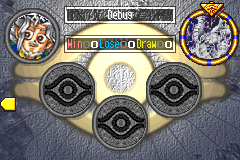

# Yak's YGO Hack

<p align="center">
  
  
  
  
</p>
<p align="center">
  
  
  
  
</p>
<p align="center">
  
  
  
  
</p>
<p align="center">
  
  
  
  
</p>
<p align="center">
  
  
  
  
</p>
<p align="center">
  
  
  
  
</p>
<p align="center">
  
  
  
  
</p>

A hack of *Yu-Gi-Oh! The Eternal Duelist Soul* (GBA) that follows the
[Format Library](https://www.formatlibrary.com/) pantheon of TCG formats, from Yugi-Kaiba up to Reaper. About 130
Goat-era cards have been added so far, with roughly 50 more planned.

## The formats

Each format is a Campaign "duelist". You start with Yugi-Kaiba only; beating a format **10 times** unlocks the
next one.

| # | Format | Banlist |
|---|---|---|
| 1 | Yugi-Kaiba | May 2002 |
| 2 | Critter | July 2002 |
| 3 | Treasure | October 2002 |
| 4 | Imperial | December 2002 |
| 5 | Android | April 2003 |
| 6 | Joey-Pegasus | May 2003 |
| 7 | Fiber | July 2003 |
| 8 | Yata | August 2003 |
| 9 | Scientist | November 2003 |
| 10 | Vampire | February 2004 |
| 11 | Chaos | April 2004 |
| 12 | Warrior | October 2004 |
| 13 | Goat | April 2005 |
| 14 | Cyber | April 2005 |
| 15 | Reaper | October 2005 |

- **Decks.** Each format duelist picks one of 2-3 (sometimes more) strong decks from its format, at weighted
  random. The first 15 duelists are fully coded. [DECKS.md](DECKS.md) lists every deck and its chance.
- **Your deck.** It has to be legal in that format's banlist and card pool to duel them.
- **Portraits.** Each duelist's portrait is its format's namesake card (or the Format Library picture when the
  format isn't named after a card).
- **No dialogue.** Duelists don't talk before or after a duel.
- **Event challengers.** On calendar event days (Championship, Duel Ceremony, Grandpa Cup, Rare Hunter), the
  challenger is drawn from the formats you've unlocked whose banlist your cards can make a 40-card deck under, with
  its original portrait and event dialogue. After the dialogue, your banlist switches to the challenger's format and
  the Deck Recipes screen opens: load a recipe, press SELECT for Deck Edit, or B to duel. In the release, a deck that
  isn't legal in the format (or is under 40 cards) can't duel until you fix it.
- **Deck Recipes.** Up to 50 saved decks. In the debug build (`make`), the first slots are premade staple decks of the
  first fifteen formats (including Goat), named after their .ydk files; the release build starts with empty slots until
  you save your own. Loading a recipe takes the cards from your trunk; any you don't have are left out (the game tells
  you which, and why). Premade recipes include Side and Extra Decks from their .ydk files. The deck recipes will
  eventually include all 15 TCG formats in release too.
- **Banlists** (main menu). Choose the banlist your deck is built under. Cards your current deck can no longer hold
  go back to the trunk. Before switching, the game checks that your cards can still make a Main Deck of at least
  40 cards under the new banlist (counting its limits and card pool); if they can't, the switch is refused.
- **Duelist Points (DP).**
  - You start with 5000 DP and earn more by winning duels.
  - The card password machine now sells cards: it shows the price and asks before buying.
  - Prices run from 5 to 3000 DP, depending on how much the card is played in the furthest format you've unlocked.
  Cards not in the current furthest format you've unlocked are priced at 3000 DP. [CARD_PRICES.md](CARD_PRICES.md) lists each format's prices.
- **Booster Packs** (main menu). TCG sets from `packs/*_tcg.json` (including **Dark Revelation Volume 1**, imported
  with `tools/import_yugipedia_drv1.py`). Only ROM cards are in each pool; pull rates follow listed rarities; the cover
  art is the pool's rarest card. The scrolling list holds 32 sets at once (booster sets first; three Structure Decks
  are omitted when more than 32 JSON files are present). 1000 DP per pack in release; free in debug (`make`).
  Campaign rewards still use the original in-game booster sets.
  The screen that shows a pack's cards no longer has the scrolling patterned background (Campaign packs too).
- **Card art in duels.** Face-up cards show a small picture of their artwork inside their icon: on the field
  (monsters, Spells/Traps, the Field zone, the top card of each Graveyard and banished pile), in your hand, in the
  card menu, in the chain list, when reordering cards, and while cards move, flip or change position. Deck Edit's
  column of cards beside the list shows each card's art too.
- **Still backgrounds.** The field background no longer scrolls during duels, and the title screen's background
  no longer scrolls either.
- **Fixes.** Deck Edit no longer blots out the first letters of the row above the cursor after Card View (a
  bug in the original game).
- **Solomon and Debug.** The opponent page after the formats has Solomon (top left) and Debug (top right), open from
  the start: before the duel you pick one of your own Deck Recipes for them to play. Beating them gives no DP, so
  they're for practice and testing decks. Against Debug you first pick your own deck the same way (a recipe, or
  one you build from 8 of every card with no limits), then Debug's; your cards and decks aren't touched, and your
  pick is used for the whole match. Debug's duels use debug mode's rules: its hand is shown face up, you can
  read its face-down cards (info bar and Card View), and you can't deck out.
  - **Building their deck.** Press SELECT on the recipe list to build their deck instead. Deck Edit opens with a
    temporary collection of 3 copies of every card and no banlist (Debug: 8 copies of every card, and no copy
    limit). Back on the list, A opens the recipe actions:
    load a recipe into their deck to start from, or save their deck to a slot. SELECT goes back to Deck Edit, B
    starts the duel with their deck, and START discards it. Your own cards, decks and banlist come back unchanged either way
    (they stay saved while you build, so a reset loses nothing).
- **Best-of-3 matches.** Every Campaign duel against the CPU is a best-of-3 match, not only on match days.
  Between games you can side, swapping cards between your Main Deck and Side Deck. Your deck goes back to how it
  was once the match ends. The CPU uses the same deck for every game of the match. Records, DP and the pack
  reward count the match, not each game.
- **Smarter CPU.**
  - **Battle and positions.**
    - It switches a monster that can't beat any of yours to Defense Position when you have a face-up monster with
      higher ATK, instead of leaving it to be run over. A monster with 1700 ATK or more stays in Attack Position
      unless your strongest monster has at least 1000 more ATK than it.
    - When it chooses Attack or Defense Position, it counts the ATK a monster will gain from an Equip Spell in its
      hand, Breaker's Spell Counter, and Blade Knight's bonus once its hand shrinks.
    - It summons a monster with 1400 or more ATK in Attack Position instead of Setting it (unless the monster has
      a flip effect, or you have a face-up monster with more ATK), even on the first turn.
    - It attacks your face-down Defense Position monsters with any monster of 1400 ATK or more, even though it
      can't see their DEF (it guesses 1400).
    - It crashes into your monsters with equal ATK when it has no better attack, unless another of its monsters
      can beat yours outright.
    - It Tribute Summons a stronger monster over weaker ones even when the swap doesn't change its attacks, such
      as Gyakutenno Megami (1800/2000) over Aqua Madoor (1200/2000), as long as the summon has more ATK and at
      least as much DEF as each monster it Tributes.
    - It never Tributes a copy of the monster it is summoning, for a Tribute Summon or a Toon's Special Summon,
      unless that monster has an effect that triggers on its summon (Zaborg, Mobius, Breaker, ...).
  - **Card use.**
    - It plays its Spells after its Normal Summon, in both Main Phases. The original CPU skipped its Spells on
      any turn it summoned to attack (always, with your field empty), after a Tribute Summon, and in Main Phase 2.
    - It uses Thunder Dragon at the start of its Main Phase. It discards one to add a single copy, then discards
      the new copy for the last one, then discards that one too, finding nothing. All three end up in its
      Graveyard. A lone copy, with none left in its Deck and not just added, stays in its hand.
    - It plays Nobleman of Crossout on your face-down monsters (the original CPU never used it).
    - It uses Solemn Judgment (the original CPU never did) while it has 4000 LP or less. It negates your Normal
      and Special Summons, your Flip Summons of flip-effect monsters, and your Spells and Traps when it has no
      cheaper answer.
    - It chains Trap Hole and its other summon Traps to your monster's summon effect (Mobius, Zaborg, ...), so it
      can destroy the monster before the effect resolves.
    - It plays Dark Hole only when you control more monsters than it does.
    - Its recruiters (Mystic Tomato, Giant Rat, UFO Turtle, Shining Fairy, Mother Grizzly, Flying Kamakiri #1,
      Pyramid Turtle, Apprentice Magician) summon another copy of themselves from the Deck when they can, so
      the next one can recruit again.
    - Its Mystical Space Typhoon (and Gust, Driving Snow) also targets your face-up Traps, and never its own cards.
    - It uses Magical Scientist with Catapult Turtle, Cannon Soldier, or Toon Cannon Soldier: it summons a Fusion
      Monster, then Tributes it for damage, and repeats while it has more than 1000 LP. Without any of those, it
      summons one Fusion Monster a turn in Main Phase 1 (with 4000 LP or more) when it could destroy one of your
      face-up monsters. Its burn monsters Tribute a Fusion Monster from Magical Scientist first, since it leaves
      at the End Phase anyway. It never fires Scientist's effect from the generic monster scan; only its dedicated
      Main Phase logic does.
    - In its Toon World strategy it Normal Summons Toon Cannon Soldier from the hand (other Toons still Special
      Summon).
    - It attacks your face-down Defense Position monsters with Sasuke Samurai and Mystic Swordsman LV2 (and any
      Defense Position monster with Ninja Grandmaster Sasuke), since their effects destroy the target whatever its
      DEF.
    - It uses Chaos Emperor Dragon's effect when the damage would win, or when you have at least 3 more cards in
      hand and on the field than it does.
    - Its Kycoo the Ghost Destroyer banishes the two strongest monsters in your Graveyard by itself (before the fix,
      you were asked to pick them).
    - It doesn't summon Thunder Nyan Nyan next to its own face-up non-LIGHT monsters, or a non-LIGHT monster next to
      it, when that would just destroy Nyan Nyan.
    - It plays Enemy Controller in Main Phase 1 to Tribute its weakest monster and take your strongest face-up one,
      when that has at least 500 more ATK.
    - Its Poison of the Old Man deals 800 damage when that wins the duel, gains 1200 LP while it has 3000 or less,
      and otherwise deals the damage.
    - It chains Emergency Provisions to your Heavy Storm, Harpie's Feather Duster or a card targeting its Spells and
      Traps, turning the cards about to go into LP; from its hand it plays it only at 1500 LP or less.
    - It chains Pikeru's Circle of Enchantment to your burn Spells and Traps that would deal it 500 or more damage
      (or finish it), before using Hallowed Life Barrier for that.
    - It activates Hallowed Life Barrier against an attack that would deal it 1500 or more damage, and in answer to
      your burn Spells and Traps (Ookazi, Tremendous Fire, ...) that would deal 800 or more; either way also when the
      damage would finish it.
    - It Special Summons Gilasaurus when your best monster to revive has less than 1500 ATK (or you have none), or
      as a Tribute for a Level 5-6 monster it couldn't summon otherwise. When you Special Summon Gilasaurus, it
      always revives a monster if it can.
    - It counts Cipher Soldier's +2000 against Warriors when it predicts a battle, for its own copy and for yours.
    - Its Set Chain Disappearance goes off on any summon of yours that it can answer.
    - It flips Threatening Roar as your Battle Phase begins when you have a face-up monster with 2000 or more ATK,
      and otherwise uses it against an attack when you have at least 2 monsters.
    - When your Spell or Trap would destroy its Set Blast with Chain (a targeted removal, Heavy Storm or Harpie's
      Feather Duster), it chains Blast with Chain onto one of its face-up monsters first, so the destruction pops it.
      Against an attack it equips Blast with Chain to one of its face-up monsters.
    - It answers your Spells with Magic Drain before Solemn Judgment, since Magic Drain costs nothing.
    - It activates Ojama Trio only when you have three empty monster zones.
    - It activates Secret Barrel in the Main Phase (or in a chain) when the damage would win, or when it would deal
      600 or more (200 per card in your hand and on your field).
    - It plays Mystik Wok at 6000 LP or less, when the weakest monster it can Tribute has 1500 or more ATK or DEF,
      and gains whichever is higher.
    - It plays Monster Reincarnation only with an empty monster field and a monster in its Graveyard to add; the
      graveyard pick favors a monster that can beat your strongest field monster.
    - It plays Toon Table of Contents only when its Deck still has a "Toon" card to search.
    - It plays Token Thanksgiving when any token is on the field (yours or its).
    - It plays Card Destruction when you hold more cards in hand than it would discard after paying the cost.
    - It plays Creature Swap when it can trade its weakest monster for one of yours with higher ATK.
    - It plays Monster Gate when it can Tribute a monster with less than 1500 ATK.
    - It plays Book of Moon when you have a face-up monster and it has a monster on the field.
    - It never activates Hysteric Fairy's effect (two Tributes for 1000 LP).
    - It plays Cold Wave in its Main Phase and does not keep playing Spells or Traps while either player's Cold Wave
      lock is active.
    - On its Standby Phase it activates face-up monsters with Standby effects on its own turn (Dark Mimic LV1's
      level-up, and the original game's Jigen Bakudan and similar cards), without waiting for you to move the cursor.
    - Its Chiron the Mage discards a Spell to destroy one of your Spells or Traps when it can, once per turn.
    - Its Bazoo the Soul-Eater activates once per turn when it has monsters in its Graveyard, banishing its three
      weakest (by ATK) for +300 ATK each until the end of your turn.
    - Its Golem Sentry and Guardian Sphinx use their once-per-turn face-down effect in the Main Phase when you control
      a monster, so their next Flip Summon can bounce yours.
    - Its Stealth Bird uses its once-per-turn face-down effect in the Main Phase whenever the menu allows (including
      while manual position changes are locked); its FLIP burn still triggers on Flip Summon and battle flips.
    - At the End Phase, its Manticore of Darkness always Special Summons itself from the Graveyard when it was sent
      there this turn and it can pay the cost: it sends its weakest Beast, Beast-Warrior, or Winged Beast from its
      field or hand to the Graveyard.
    - D.D. Survivor is mandatory: if a face-up copy is banished from the field or the Graveyard (including as Bazoo or
      a Chaos summon cost), it Special Summons itself in that End Phase when there is a free zone; the CPU picks
      Attack or Defense like any other Special Summon.
    - It Sets Wave-Motion Cannon from its hand and later ignites it after at least two of its Standby Phases have
      passed, or sooner when the burn would win the duel.
    - It pays Exarion Universe's ATK cost for piercing damage when its ATK minus 400 still beats your Defense Position
      monster's DEF.
    - Its Roulette Barrel keeps the die that matches the Level of your strongest face-up monster, so it destroys
      the best target it can.
    - It plays Level Limit - Area B, Gravity Bind, Final Attack Orders and Royal Oppression in its Main Phase. It
      uses Royal Oppression against your Special Summons while it has more than 800 LP.
    - Its Dark Scorpion - Cliff the Trap Remover picks its Spell or Trap target like Mystical Space Typhoon does.
    - When you attack into its flip monsters that remove or stop a monster (Man-Eater Bug, Hane-Hane, Penguin
      Soldier, Dark-Eyes Illusionist, Night Assailant, Tsukuyomi), it targets your strongest monster that hasn't
      attacked yet, so it can't attack this turn.
    - It never activates a card whose LP cost or self-damage would drop its own LP to 0 (Premature Burial,
      Cyber Stein, Tremendous Fire, a lost Time Wizard toss, ...).
  - **What it can see.** It no longer knows the ATK or DEF of your face-down monsters. It assumes 1400 for both
    when deciding whether to attack one, judging how threatening your field is, and choosing targets for its
    effects.
- **Thunder Dragon** can be activated even with no copy left in the Deck; the search then finds nothing.
- **Debug mode** (testing builds only, not in the release). You start with 8 copies of every card, and you can't
  deck out. Decks can be under 40 cards, can hold any number of copies of a card, and ignore banlists. Switching
  banlists skips the 40-card Main Deck check. Every format is unlocked, and the Record (Duel Score) screen
  shows every duelist on every page. The opponent's hand is shown face up during
  duels, and the cursor shows the info of all their cards (face-down ones too), with Card View. The deck
  opponents' page has a third opponent, Test Duel (right), whose deck is `C:\ProjectIgnis\deck\test.ydk` as it
  is when the ROM is built.

### Planned

- 8 actual duelists: Yugi Muto, Joey, Kaiba, Pegasus, Marik, Yami Marik, Yami Bakura and Yami Yugi.
- The OCG formats up to Victory, unlocked after beating Reaper.

## How the new cards are added

- **Coded cards.** Every card listed in [`new_cards.txt`](new_cards.txt) above the `------` line is fully coded,
  effects included; the lines below the separator are planned, not in the demo ROM yet.
- **Card data.** `make` / `make release` use every name in `config/new_cards.txt`. `make demo` / `make release-demo`
  use only the coded block at the top of repo-root `new_cards.txt`. The build fetches each card's stats, text and
  artwork from [YGOPRODeck](https://ygoprodeck.com/api-guide/) and appends it to the game's card tables
  (`tools/newcards.py`).
- **Effects.** Effects are written in C on top of the original duel engine, mostly in `src/added_effects.c`. Each
  card gets the same handlers the game's own cards use: activation check, cost, targeting, resolution. Small hooks
  in the engine cover timings it doesn't already have, and each card gets a rule for when the computer should use it.
- **Engine leftovers.** The engine already contains several cards that never made it into EDS, such as Magic
  Cylinder, Soul Exchange, Fairy Box and Thousand-Eyes Restrict. Those reuse that existing code instead of being
  written from scratch.

## Playing

Ready-made IPS patches are in the [`patches/`](patches/) folder: a release build and a debug build (the demo, up to
Reaper). Apply one to your own USA ROM of *The Eternal Duelist Soul* (AY5E) with any IPS patcher, or let an emulator
that auto-loads patches, such as mGBA, apply it.

## Building

This hack is built on a [matching decompilation](wiki/overview.md) of the game. You need your own copy of the USA ROM;
it is never included.

```
(cd ../agbcc && ./build.sh)    # once: pret/agbcc checked out next to this repository
make setup                     # once: put your ROM in roms/ and extract the game data
make -j$(nproc)                # eds.gba: the debug/testing build (config/new_cards.txt)
make -j$(nproc) release        # eds_release.gba: the release build
make -j$(nproc) demo           # eds_demo.gba: debug build, cards in new_cards.txt above ------
make -j$(nproc) release-demo   # eds_release_demo.gba: release build, same demo card pool
```

You need `make`, `cpp`, `python3` and `binutils-arm-none-eabi`, plus network access the first time new cards are
fetched. See `CLAUDE.md` and the `wiki/` for details on the decompilation and the hack.
