<h1 align="center">Yak's YGO Hack</h1>

<p align="center">
  <em>Yu-Gi-Oh! The Eternal Duelist Soul</em> (GBA), rebuilt around the classic TCG formats,<br>
  from Yugi-Kaiba all the way to Reaper.
</p>

<p align="center">
  
  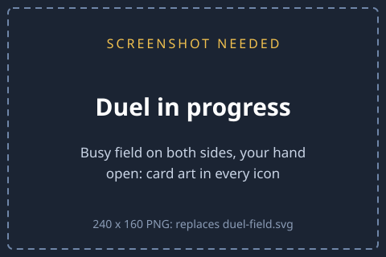
</p>

<p align="center">
  <a href="#play-it"><strong>Play it</strong></a> ·
  <a href="#the-formats">Formats</a> ·
  <a href="#decks-and-banlists">Decks</a> ·
  <a href="#cards-packs-and-dp">Packs and DP</a> ·
  <a href="#in-the-duel">Duels</a> ·
  <a href="#practice-opponents">Practice</a> ·
  <a href="#the-new-cards">New cards</a> ·
  <a href="#building-from-source">Build</a>
</p>

## Highlights

|  |  |
|---|---|
| **15 formats** | Follows the [Format Library](https://www.formatlibrary.com/) pantheon of TCG formats. Each one is a Campaign duelist with its own banlist, card pool and decks. |
| **New cards** | The demo adds **152** cards. The full list has **343** names so far and is still growing. |
| **Smarter CPU** | Opponents play much stronger than in vanilla EDS. See [AI_IMPROVEMENTS.md](AI_IMPROVEMENTS.md) and [AI_QUIRKS.md](AI_QUIRKS.md). |
| **Best-of-3 matches** | Every Campaign duel is a match, with siding between games. |
| **A real economy** | Earn Duelist Points, buy cards by password, and open TCG sets and usage-weighted packs. |
| **Deck tools** | 60 Deck Recipes, a choice of banlists, and practice opponents that play decks you pick. |

## Play it

Ready-made **BPS** patches are in the [`patches/`](patches/) folder: a release build and a debug build (the demo, up to
Reaper). You need your own USA ROM of *The Eternal Duelist Soul* (AY5E); it is never included.

1. Open [Rom Patcher JS](https://www.marcrobledo.com/RomPatcher.js/) in your browser.
2. Choose your ROM as the input file.
3. Choose the `.bps` from `patches/`.
4. Download the patched ROM.

## The formats

Each format is a Campaign duelist. You start with Yugi-Kaiba only. Beat the current format duelist **20 times** in the
release to unlock the next one (every format is open in the debug build).

<table>
<tr>
<td></td>
<td></td>
<td></td>
</tr>
</table>

| # | Format | Banlist | | # | Format | Banlist |
|---|---|---|---|---|---|---|
| 1 | Yugi-Kaiba | May 2002 | | 9 | Scientist | November 2003 |
| 2 | Critter | July 2002 | | 10 | Vampire | February 2004 |
| 3 | Treasure | October 2002 | | 11 | Chaos | April 2004 |
| 4 | Imperial | December 2002 | | 12 | Warrior | October 2004 |
| 5 | Android | April 2003 | | 13 | Goat | April 2005 |
| 6 | Joey-Pegasus | May 2003 | | 14 | Cyber | April 2005 |
| 7 | Fiber | July 2003 | | 15 | Reaper | October 2005 |
| 8 | Yata | August 2003 | | | | |

- **Decks.** Each format duelist picks one of 2-3 (sometimes more) strong decks from its format, at weighted random. The
  first 15 duelists are fully coded. [DECKS.md](DECKS.md) lists every deck and its chance.
- **Your deck.** It has to be legal in that format's banlist and card pool to duel them.
- **Portraits.** Each duelist's portrait is its format's namesake card, or the Format Library picture when the format
  isn't named after a card.
- **No dialogue.** Duelists don't talk before or after a duel.

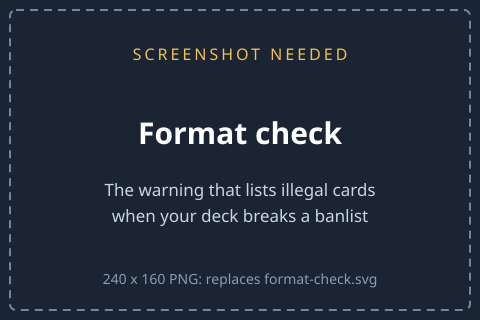

### Event challengers

On calendar event days (Championship, Duel Ceremony, Grandpa Cup, Rare Hunter), the challenger is drawn from the formats
you've unlocked whose banlist your cards can make a 40-card deck under. It keeps its original portrait and event
dialogue.

After the dialogue, your banlist switches to the challenger's format and the Deck Recipes screen opens: load a recipe,
press SELECT for Deck Edit, or press B to duel. In the release, a deck that isn't legal in the format (or is under 40
cards) can't duel until you fix it.

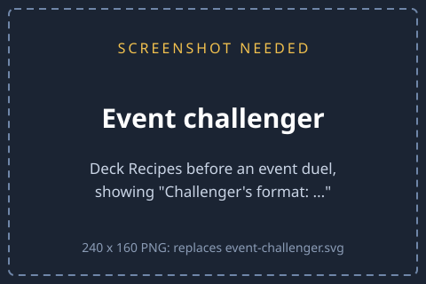

## Decks and banlists

<table>
<tr>
<td align="center"><br><sub>Deck Recipes in the main menu</sub></td>
<td align="center"><br><sub>Your saved recipes</sub></td>
<td align="center">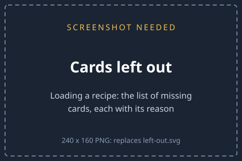<br><sub>Cards a recipe left out</sub></td>
</tr>
<tr>
<td align="center"><br><sub>Banlists in the main menu</sub></td>
<td align="center">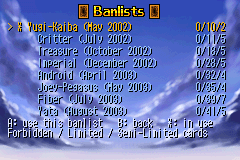<br><sub>Choosing a banlist</sub></td>
<td align="center"><br><sub>Deck Edit, with card art</sub></td>
</tr>
</table>

### Deck Recipes

- Save up to **60** decks.
- Loading a recipe takes the cards from your trunk. Any you don't have are left out, and the game tells you which and
  why.
- In the debug build (`make`), the first slots are premade staple decks of the first fifteen formats (including Goat),
  named after their `.ydk` files. Premade recipes include Side and Extra Decks from those files.
- The release build starts with empty slots until you save your own. The deck recipes will eventually include all 15
  TCG formats in release too.

### Banlists

Choose the banlist your deck is built under from the main menu. Cards your current deck can no longer hold go back to
the trunk. Before switching, the game checks that your cards can still make a Main Deck of at least 40 cards under the
new banlist, counting its limits and card pool. If they can't, the switch is refused.

## Cards, packs and DP

<table>
<tr>
<td align="center"><br><sub>Booster Packs in the main menu</sub></td>
<td align="center"><br><sub>The pack list</sub></td>
<td align="center">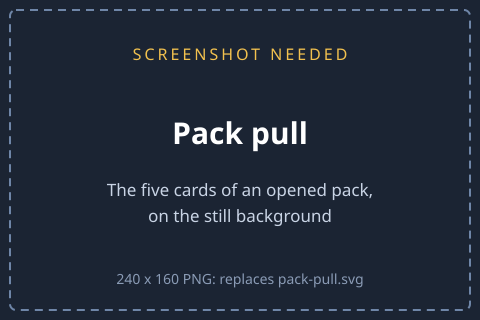<br><sub>An opened pack</sub></td>
</tr>
<tr>
<td align="center">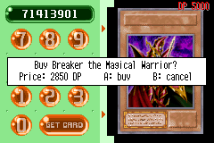<br><sub>Buying a card by password</sub></td>
<td align="center"><br><sub>The free pack reward</sub></td>
<td></td>
</tr>
</table>

### Duelist Points (DP)

- You start with **5000 DP** and earn more by winning duels.
- The card password machine now sells cards: it shows the price and asks before buying.
- Cards that appear in a format's usage statistics cost **200 to 3000 DP** within that format (usage share, with
  Limited/Semi-Limited multipliers, then linearly scaled). Cards with no usage entry cost **100 DP**.
  Per-format prices are listed in [CARD_PRICES.md](CARD_PRICES.md).

### Booster Packs

| Pack | Comes from | Unlocks | Price |
|---|---|---|---|
| **TCG sets** | Yu-Gi-Oh! TCG booster sets (through *Starter Deck 2006*, including *Dark Revelation* reprints) | When its format opponent unlocks (for example Metal Raiders with Critter) | **250 DP** |
| **Usage-weighted packs** | One per format, from cards priced by that format's usage statistics | After **10 wins** against that format duelist | **500 DP** |

- Only cards in the ROM are in each pool, pull rates follow listed rarities, and the cover art is the pool's rarest card.
  Per-pack weights and pull percentages are in [PACKS.md](PACKS.md).
- **Campaign wins** against format duelists (not Solomon or Debug) use this same unlocked list: pick **one free pack**
  after the duel. When a win opens new packs (a usage pack at 10 wins in that format, or TCG sets when the next format
  unlocks at 20 wins), the game shows the **"new packs are available"** message before the list.

### Usage stats and Mobius

Card DP and the usage-weighted booster pools come from [Format Library](https://www.formatlibrary.com/) tournament usage
data. **[Mobius](https://github.com/Soul-8691/Mobius)** is a companion Python app for exploring those stats in a table
(ban-weighted counts, Limited/Semi-Limited multipliers, YGOPRODeck names and art).

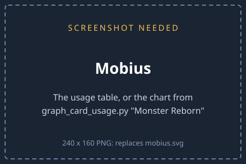

<details>
<summary>Running Mobius</summary>

<br>

Clone that repository, then with Python 3.9 or newer:

```
pip install -r requirements.txt
python main.py
```

- **Formats.** A format appears in the dropdown when it has both a pool file under `data/format_library/pools/` and a
  matching usage file under `data/format_library/usage/`. Usage is read from each JSON's top-level `main` array; pool
  cards with no entry count as zero.
- **Card data.** On first launch the app downloads the full YGOPRODeck v7 database to
  `data/cache/ygopro/card_database.json`. Run `python download_ygopro_database.py` to refresh it. Card images cache under
  `data/cache/ygopro/images/` as you scroll.
- **Charts.** For one card's usage across formats as a line chart, run `python graph_card_usage.py "Monster Reborn"`
  (optional `--start yugi-kaiba --end goat` and `-o chart.png`; format stems match the pool filenames, e.g. `yugi-kaiba`,
  `cat`).

See Mobius's README for chart semantics and options.

</details>

## In the duel

<table>
<tr>
<td align="center"><br><sub>Card art in your hand</sub></td>
<td align="center"><br><sub>Summon comes before Set</sub></td>
<td align="center"><br><sub>Activate comes before Set</sub></td>
</tr>
<tr>
<td align="center">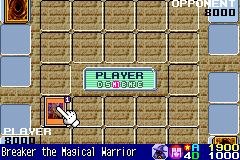<br><sub>Counters</sub></td>
<td align="center">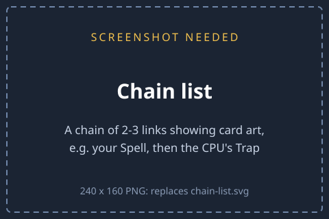<br><sub>The chain list</sub></td>
<td align="center">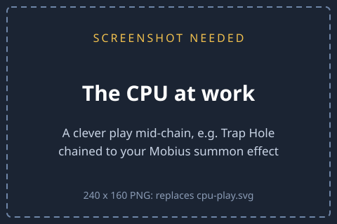<br><sub>The CPU at work</sub></td>
</tr>
<tr>
<td align="center"><br><sub>Settings in the main menu</sub></td>
<td align="center">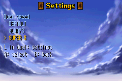<br><sub>Duel speed</sub></td>
<td align="center">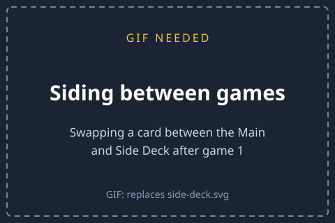<br><sub>Siding between games</sub></td>
</tr>
</table>

- **Best-of-3 matches.** Every Campaign duel against the CPU is a best-of-3 match, not only on match days. Between games
  you can side, swapping cards between your Main Deck and Side Deck, and your deck goes back to how it was once the match
  ends. The CPU uses the same deck for every game of the match. Records, DP and the pack reward count the match, not each
  game.
- **Smarter CPU.** Campaign opponents play much stronger than vanilla EDS. [AI_QUIRKS.md](AI_QUIRKS.md) lists
  vanilla AI shortcomings that were fixed (original-roster cards only). [AI_IMPROVEMENTS.md](AI_IMPROVEMENTS.md)
  describes current CPU behavior in full.
- **Card art.** Face-up cards show a small picture of their artwork inside their icon: on the field (monsters,
  Spells/Traps, the Field zone, the top card of each Graveyard and banished pile), in your hand, in the card menu, in the
  chain list, when reordering cards, and while cards move, flip or change position. Deck Edit's column of cards beside
  the list shows each card's art too.
- **Settings.** Open them from the main menu, or press **L** during a duel; leaving with **B** returns to the duel when
  you opened them with L. The choice is saved. Pick one duel speed:

  | Speed | What it does |
  |---|---|
  | **DEFAULT** | Hold B to fast-forward |
  | **ALWAYS** | Always fast-forward |
  | **SUPER** | Always fast-forward, with doubled skip amounts |

- **Still backgrounds.** The field background, the title screen's background and the pack pull screen's patterned
  background (Campaign packs too) no longer scroll.
- **Menu order.** In the hand/field card menu, **Summon** comes before **Set**, **Activate** comes before **Set** for
  Spells you can activate or Set, and **Card Info** is always the last option. Left/Right order matches the row.
- **Fixes.** Deck Edit no longer blots out the first letters of the row above the cursor after Card View, a bug in the
  original game.
- **Cards can fail to find.** Cards like Thunder Dragon and Toon Table of Contents can be activated even with no copy
  left in the Deck; the search then finds nothing.

## Practice opponents

The opponent page after the formats has **Solomon** (top left) and **Debug** (top right), open from the start. Before the
duel you pick one of your own Deck Recipes for them to play. Beating them gives no DP, so they're for practice and
testing decks.

<table>
<tr>
<td align="center"><br><sub>The practice page</sub></td>
<td align="center">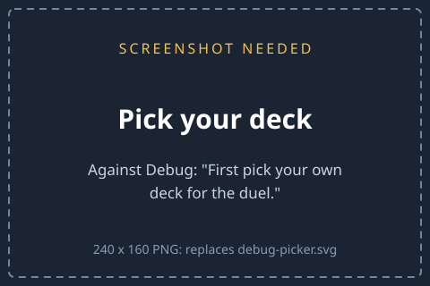<br><sub>Picking your deck</sub></td>
<td align="center">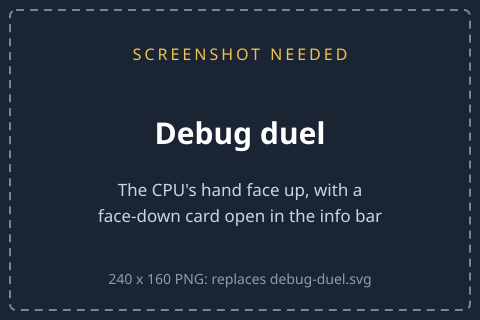<br><sub>A duel with Debug</sub></td>
</tr>
</table>

- **Building their deck.** Press SELECT on the recipe list to build their deck instead. Deck Edit opens with a temporary
  collection and no banlist: 3 copies of every card for Solomon, or 8 copies with no copy limit for Debug.
- **Back on the list:**

  | Button | What it does |
  |---|---|
  | **A** | Opens the recipe actions: load a recipe into their deck to start from, or save their deck to a slot |
  | **SELECT** | Goes back to Deck Edit |
  | **B** | Starts the duel with their deck |
  | **START** | Discards their deck |

- **Your collection is safe.** Your own cards, decks and banlist come back unchanged either way. They stay saved while
  you build, so a reset loses nothing.
- **Your deck against Debug.** You first pick your own deck the same way (a recipe, or one you build from 8 of every card
  with no limits), then Debug's. Your cards and decks aren't touched, and your pick is used for the whole match.
- **Debug's rules.** Debug's duels use debug mode's rules: its hand is shown face up, you can read its face-down cards
  (info bar and Card View), you can open its main and fusion deck piles in order, and neither side can deck out.

## The new cards

The demo build (`make demo`) adds **152** cards, listed in alphabetical order above `------` in
[`new_cards.txt`](new_cards.txt). **[NEW_CARDS.md](NEW_CARDS.md)** shows each of them in Deck Edit's Card View.

<table>
<tr>
<td></td>
<td></td>
<td></td>
</tr>
<tr>
<td></td>
<td></td>
<td></td>
</tr>
</table>

<details>
<summary>More cards</summary>

<br>

<table>
<tr>
<td></td>
<td></td>
<td></td>
</tr>
<tr>
<td></td>
<td></td>
<td></td>
</tr>
</table>

See [NEW_CARDS.md](NEW_CARDS.md) for all of them.

</details>

> [!NOTE]
> These demo-list Fusion Monsters are **not** fully implemented yet (no fusion effects, and they do not behave like their
> real cards): Cyber Blader, Dark Balter the Terrible, Dark Blade the Dragon Knight, Dark Flare Knight, Dark Paladin,
> Fiend Skull Dragon, Gatling Dragon, King Dragun, Master of Oz, Ojama King, Reaper on the Nightmare, Ryu Senshi, and The
> Last Warrior from Another Planet.

### How they're added

- **Coded cards.** Every card above the `------` line in [`new_cards.txt`](new_cards.txt) is in the demo ROM with stats,
  text and art. The lines below the separator are planned, not in the demo ROM yet.
- **Card data.** The build fetches each card's stats, text and artwork from
  [YGOPRODeck](https://ygoprodeck.com/api-guide/) and appends it to the game's card tables (`tools/newcards.py`).
- **Effects.** Effects are written in C on top of the original duel engine, mostly in `src/added_effects.c`. Each card
  gets the same handlers the game's own cards use: activation check, cost, targeting, resolution. Small hooks in the
  engine cover timings it doesn't already have, and each card gets a rule for when the computer should use it.
- **Engine leftovers.** The engine already contains several cards that never made it into EDS, such as Magic Cylinder,
  Soul Exchange, Fairy Box and Thousand-Eyes Restrict. Those reuse that existing code instead of being written from
  scratch. The full inventory (157 unused card numbers and what each handler does) is in
  [LEFTOVER_EFFECTS.md](https://github.com/Soul-8691/eds-decomp/blob/binary/LEFTOVER_EFFECTS.md) on the
  [`binary`](https://github.com/Soul-8691/eds-decomp/tree/binary) branch.
- **Gallery screenshots.** [NEW_CARDS.md](NEW_CARDS.md) is taken by `tools/card_screenshots.lua` in mGBA (optional
  `cards/_capture_only.txt` for new entries only), and `tools/gen_new_cards_md.py` refreshes the gallery. Reorder
  `new_cards.txt` only together with **`make demo`**, so card IDs stay in sync before re-running the script.

## Planned

- 8 actual duelists: Yugi Muto, Joey, Kaiba, Pegasus, Marik, Yami Marik, Yami Bakura and Yami Yugi.
- The OCG formats up to Victory, unlocked after beating Reaper.

## Building from source

This hack is built on a [matching decompilation](wiki/overview.md) of the game. You need your own copy of the USA ROM; it
is never included.

```
(cd ../agbcc && ./build.sh)    # once: pret/agbcc checked out next to this repository
make setup                     # once: baserom.gba in repo root or your ROM in roms/, then extract assets
make -j$(nproc)                # eds.gba: the debug/testing build (config/new_cards.txt)
make -j$(nproc) release        # eds_release.gba: the release build
make -j$(nproc) demo           # eds_demo.gba: debug build, cards in new_cards.txt above ------
make -j$(nproc) release-demo   # eds_release_demo.gba: release build, same demo card pool
```

You need `make`, `cpp`, `python3` and `binutils-arm-none-eabi`, plus network access the first time new cards are fetched.
See `CLAUDE.md` and the `wiki/` for details on the decompilation and the hack.

| Target | Rules | Card list |
|---|---|---|
| `make` | Debug/testing (`MOD_RELEASE` 0) | Every name in `config/new_cards.txt` |
| `make release` | Release | Every name in `config/new_cards.txt` |
| `make demo` | Debug/testing (`MOD_RELEASE` 0) | The coded block at the top of `new_cards.txt` |
| `make release-demo` | Release | The coded block at the top of `new_cards.txt` |

<details>
<summary>Debug mode (testing builds only, not in the release)</summary>

<br>

**Starting out**

- You start with 8 copies of every card.
- On **New Game**, choosing the **red** starter deck leaves your saved Main, Fusion and Side Decks **empty** (build from
  the trunk). Green and black still load their premade Yugi-Kaiba recipe decks.

**Deck rules**

- Decks can be under 40 cards, can hold any number of copies of a card, and ignore banlists.
- Switching banlists skips the 40-card Main Deck check.

**Duels**

- **Deck-out is off** in every Campaign duel, format opponents included. Link Battles still use normal deck-out rules.
  In the **release** build, deck-out is blocked only vs **Debug**, and **Test Duel** is not offered.
- The opponent's hand is shown face up, and the cursor shows the info of all their cards (face-down ones too), with Card
  View.
- You can open your deck pile from the command menu (Draw / Surrender / Card View), and the opponent's main or fusion
  deck pile with **Card View** (draw order on the main deck; works even when their deck is empty).

**Menus**

- Every format is unlocked, and the Record (Duel Score) screen shows every duelist on every page.

**Test Duel**

The deck opponents' page (fourth page, right slot) has **Test Duel**, whose deck is the `.ydk` in `TEST_YDK` (default
`/mnt/c/ProjectIgnis/deck/test.ydk`) as read when the ROM is built. Only cards in **that** build exist: for `make demo`,
every passcode in the deck must be among the coded cards in repo-root `new_cards.txt` above `------`. Passcodes that are
missing are dropped, and if none remain the opponent starts with **no deck** (not the vanilla Duel Computer deck). An
empty `.ydk` does the same.

</details>
