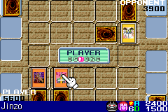

<h1 align="center">Yak's YGO Hack</h1>

<p align="center">
  <em>Yu-Gi-Oh! The Eternal Duelist Soul</em> (GBA), rebuilt around the classic TCG formats<br>
  from Yugi-Kaiba (May 2002) to Reaper (October 2005).
</p>

<p align="center">
  
  
</p>

<p align="center">
  <a href="#play-it"><strong>Play it</strong></a> ·
  <a href="#the-campaign">Campaign</a> ·
  <a href="#decks-and-banlists">Decks</a> ·
  <a href="#cards-packs-and-dp">Packs and DP</a> ·
  <a href="#in-the-duel">Duels</a> ·
  <a href="#synchro-xyz-and-link">Synchro, Xyz, Link</a> ·
  <a href="#the-new-cards">New cards</a> ·
  <a href="#building-from-source">Build</a> ·
  <a href="#editing-with-hex-maniac-advance">HMA</a> ·
  <a href="#debug-and-testing-builds">Debug</a>
</p>

## Highlights

|  |  |
|---|---|
| **15 formats** | Follows the [Format Library](https://www.formatlibrary.com/) pantheon of historical TCG formats, May 2002 to October 2005. Each one is a Campaign duelist with its own card pool and decks. |
| **New cards** | The demo adds **308** cards. See [NEW_CARDS.md](NEW_CARDS.md). |
| **Synchro, Xyz and Link** | Summoned from the Fusion Deck (the Extra Deck), with Tuners, Xyz Materials, Link Arrows and Extra Monster Zones. You pick the Monster Zone for every summon. See [Synchro, Xyz and Link](#synchro-xyz-and-link). |
| **Smarter CPU** | Opponents play much stronger than in vanilla EDS. See [AI_IMPROVEMENTS.md](AI_IMPROVEMENTS.md) and [AI_QUIRKS.md](AI_QUIRKS.md). |
| **Best-of-3 matches** | Every Campaign duel is a match, with siding between games. |
| **A real economy** | Earn Duelist Points, buy cards by password, and open TCG sets and usage-weighted packs. |
| **Deck tools** | 60 Deck Recipes, a choice of banlists, and practice opponents that play decks you pick. |
| **Editable** | Every build can come with a Hex Maniac Advance `.toml` that labels the mod's data: deck chances, packs, prices, cards, screens. |

## Play it

Ready-made **BPS** patches are in the [`patches/`](patches/) folder: a release build and a debug build (the demo, up to
Reaper). You need your own USA ROM of *The Eternal Duelist Soul* (AY5E); it is never included.

1. Open [Rom Patcher JS](https://www.marcrobledo.com/RomPatcher.js/) in your browser.
2. Choose your ROM as the input file.
3. Choose the `.bps` from `patches/`.
4. Download the patched ROM.

The title screen's top right says whether it's the Release or Debug build; demo builds show the demo version at the
top left.

## The Campaign

> [!NOTE]
> [Format Library](https://www.formatlibrary.com/) is an independent site: a collection of retro Yu-Gi-Oh! TCG format
> information. **This project is not affiliated with Format Library in any way.**

Each format is a Campaign duelist. You start with Yugi-Kaiba only. Beat the current format duelist **20 times** in the
release to unlock the next one (every format is open in the debug build).

<table>
<tr>
<td></td>
<td></td>
<td></td>
</tr>
</table>

| # | Format | Banlist | | # | Format | Banlist |
|---|---|---|---|---|---|---|
| 1 | Yugi-Kaiba | May 2002 | | 9 | Scientist | November 2003 |
| 2 | Critter | July 2002 | | 10 | Vampire | February 2004 |
| 3 | Treasure | October 2002 | | 11 | Chaos | April 2004 |
| 4 | Imperial | December 2002 | | 12 | Warrior | October 2004 |
| 5 | Android | April 2003 | | 13 | Goat | April 2005 |
| 6 | Joey-Pegasus | May 2003 | | 14 | Cyber | April 2005 |
| 7 | Fiber | July 2003 | | 15 | Reaper | October 2005 |
| 8 | Yata | August 2003 | | | | |

### Format duelists

- **Their decks.** Each format duelist picks one of 2-3 (sometimes more) strong decks from its format, at weighted
  random. All 15 are fully coded. [DECKS.md](DECKS.md) lists every deck and its chance.
- **Deck chances.** Each format has 10 deck slots with a chance out of 100 each (unused slots get 0). With the
  [HMA `.toml`](#editing-with-hex-maniac-advance) you can change them under `data.decks.choices.<format>`.
- **Your deck.** It has to be legal in that format's banlist and card pool to duel them.
- **Portraits.** Each duelist's portrait is its format's namesake card, or the Format Library picture when the format
  isn't named after a card.

### The pre-duel screen

Campaign opponents (and Solomon and Debug, after you pick their deck) get a pre-duel screen instead of vanilla
dialogue: custom text in the dialogue box, a Format Library QR code, and either a format picture (Yugi-Kaiba through
Android) or the opponent's original bust-up scene with blinking eyes. Press **A** to continue. A New Game skips Tea's
intro, and there is no post-duel dialogue.

### Best-of-3 matches

Every Campaign duel against the CPU is a best-of-3 match, not only on match days. Between games you can side, swapping
cards between your Main Deck and Side Deck, and your deck goes back to how it was once the match ends. The CPU uses the
same deck for every game of the match. Records, DP and the pack reward count the match, not each game.

### Event challengers

On calendar event days (Championship, Duel Ceremony, Grandpa Cup, Rare Hunter), the challenger is drawn from the formats
you've unlocked whose banlist your cards can make a 40-card deck under. It keeps its original portrait and event
dialogue.

After the dialogue, your banlist switches to the challenger's format and the Deck Recipes screen opens: load a recipe,
press SELECT for Deck Edit, or press B to duel. In the release, a deck that isn't legal in the format (or is under 40
cards) can't duel until you fix it.

## Practice opponents


The opponent page after the formats is open from the start:

| Slot | Opponent | Deck | Rules |
|---|---|---|---|
| Top left | **Solomon** | A Deck Recipe you pick or build (3 of every card) | Normal |
| Top right | **Debug** | A Deck Recipe you pick or build (8 of every card, no copy limit) | Debug mode's |
| Middle right | **Empty Deck** | None at all | Nobody decks out |
| Middle left | **Test Duel** | A `.ydk` file (testing builds only) | Debug mode's |

None of them give DP or a pack, and none check your deck's format: they're for practice and testing decks. The Records
screen has a page for them too.

### Solomon and Debug

Before the duel you pick one of your own Deck Recipes for them to play.

- **Building their deck.** Press SELECT on the recipe list to build their deck instead. Deck Edit opens with a temporary
  collection and no banlist: 3 copies of every card for Solomon, or 8 copies with no copy limit for Debug.
- **Your collection is safe.** Your own cards, decks and banlist come back unchanged either way. They stay saved while
  you build, so a reset loses nothing.
- **Your deck against Debug.** You first pick your own deck the same way (a recipe, or one you build from 8 of every card
  with no limits), then Debug's. Your cards and decks aren't touched, and your pick is used for the whole match. Your
  deck may be empty (an empty recipe slot, or B in the deck builder with no cards): the duel starts with no cards.
- **Debug's rules.** Debug's duels use [debug mode's rules](#duels): its hand is shown face up, you can read its
  face-down cards (info bar and Card View), you can open its main and fusion deck piles in order, and neither side can
  deck out. The [debug controls](#debug-controls) work too.

Back on the recipe list:

| Button | What it does |
|---|---|
| **A** | Opens the recipe actions: load a recipe into their deck to start from, or save their deck to a slot |
| **SELECT** | Goes back to Deck Edit |
| **B** | Starts the duel with their deck |
| **START** | Discards their deck |

### Empty Deck

A CPU with no cards at all (Ultimate Offering's picture), in the release too. Any deck may challenge it, and neither
player decks out, so you can try your deck's combos against an open board.

### Mulligan

In your first Draw Phase, your Main Deck menu offers **Mulligan** next to **Draw**: your hand goes to the bottom of the
Main Deck, the deck shuffles, and you draw five again. Repeat until you **Draw**, which ends mulligan for that duel. In
the **release** build, mulligan is offered only in duels against **Debug**. In **testing** builds (`make`, `make demo`,
…), every Campaign duel offers it.

## Decks and banlists

<table>
<tr>
<td align="center"><br><sub>Deck Recipes in the main menu</sub></td>
<td align="center"><br><sub>Your saved recipes</sub></td>
<td align="center"><br><sub>Deck Edit, with card art</sub></td>
</tr>
<tr>
<td align="center"><br><sub>Banlists in the main menu</sub></td>
<td align="center"><br><sub>Choosing a banlist</sub></td>
<td></td>
</tr>
</table>

### Deck Recipes

- Save up to **60** decks.
- Loading a recipe takes the cards from your trunk. Any you don't have are left out, and the game tells you which and
  why.
- In the debug build (`make`), the first slots are premade staple decks of the first fifteen formats (including Goat),
  named after their `.ydk` files. Premade recipes include Side and Extra Decks from those files.
- The release build starts with empty slots until you save your own. The deck recipes will eventually include all 15
  TCG formats in release too.

### Banlists

Choose the banlist your deck is built under from the main menu. Cards your current deck can no longer hold go back to
the trunk. Before switching, the game checks that your cards can still make a Main Deck of at least 40 cards under the
new banlist, counting its limits and card pool. If they can't, the switch is refused.

### Deck Edit

- **List Filter.** After you choose a card category and sort order, a new page narrows the list by the name's first
  letter, one Type, one Attribute, and ATK, DEF and Level ranges. Magic and Trap lists get the letter only. Sorting by
  Type or Attribute is now alphabetical.
- **Empty Main/Side.** The bottom command that vanilla calls **Exit** is **Empty Main/Side**: every card in your Main
  Deck, Side Deck and Fusion Deck goes back to the trunk, and you stay in Deck Edit.
- **Card art.** The column of cards beside the list shows each card's art.

## Cards, packs and DP

<table>
<tr>
<td align="center"><br><sub>Booster Packs in the main menu</sub></td>
<td align="center"><br><sub>The pack list</sub></td>
<td align="center"><br><sub>Buying a card by password</sub></td>
</tr>
</table>

### Duelist Points (DP)

- You start with **5000 DP** and earn more by winning duels.
- The card password machine now sells cards: it shows the price and asks before buying.
- Cards that appear in a format's usage statistics cost **200 to 3000 DP** within that format (usage share, with
  Limited/Semi-Limited multipliers, then linearly scaled). Cards with no usage entry cost **100 DP**. Per-format prices
  are listed in [CARD_PRICES.md](CARD_PRICES.md).

### Booster Packs

| Pack | Comes from | Unlocks | Price |
|---|---|---|---|
| **TCG sets** | Yu-Gi-Oh! TCG booster sets (through *Starter Deck 2006*) | When its format opponent unlocks (for example Metal Raiders with Critter) | **250 DP** |
| **Usage-weighted packs** | One per format, from cards priced by that format's usage statistics | After **10 wins** against that format duelist | **500 DP** |

- Only cards in the ROM are in each pool, pull rates follow listed rarities, and the cover art is the pool's rarest
  card. Per-pack weights and pull percentages are in [PACKS.md](PACKS.md).
- **Campaign wins** against format duelists (not the practice opponents) reward **one random unlocked TCG format pack**
  (not a usage pack), chosen when the reward starts.
- When a win opens new packs (a usage pack at 10 wins in that format, or TCG sets when the next format unlocks at 20
  wins), the game shows the **"new packs are available"** message before the list.

### Usage stats and Mobius

Card DP and the usage-weighted booster pools come from [Format Library](https://www.formatlibrary.com/) tournament usage
data, gathered **with the site's creator's permission**. **[Mobius](https://github.com/Soul-8691/Mobius)** is a
companion Python app for exploring those stats in a table (ban-weighted counts, Limited/Semi-Limited multipliers,
YGOPRODeck names and art).

<details>
<summary>Running Mobius</summary>

<br>

Clone that repository, then with Python 3.9 or newer:

```
pip install -r requirements.txt
python main.py
```

- **Formats.** A format appears in the dropdown when it has both a pool file under `data/format_library/pools/` and a
  matching usage file under `data/format_library/usage/`. Usage is read from each JSON's top-level `main` array; pool
  cards with no entry count as zero.
- **Card data.** On first launch the app downloads the full YGOPRODeck v7 database to
  `data/cache/ygopro/card_database.json`. Run `python download_ygopro_database.py` to refresh it. Card images cache under
  `data/cache/ygopro/images/` as you scroll.
- **Charts.** For one card's usage across formats as a line chart, run `python graph_card_usage.py "Monster Reborn"`
  (optional `--start yugi-kaiba --end goat` and `-o chart.png`; format stems match the pool filenames, e.g. `yugi-kaiba`,
  `cat`).

See Mobius's README for chart semantics and options.

</details>

## In the duel

<table>
<tr>
<td align="center"><br><sub>Card art in your hand</sub></td>
<td align="center"><br><sub>Summon comes before Set</sub></td>
<td align="center"><br><sub>Activate comes before Set</sub></td>
</tr>
<tr>
<td align="center"><br><sub>Spell Counters</sub></td>
<td align="center"><br><sub>The full board</sub></td>
<td align="center"><br><sub>The chain list</sub></td>
</tr>
</table>

### The duel screen

- **Layout.** Your life points are at the bottom left and your opponent's at the top right, under "PLAYER" and
  "OPPONENT". The middle row of the board has one shared phase panel (whose turn it is, and D S M B M E with the current
  phase lit) between the two Extra Monster Zones.
- **Card art.** Face-up cards show a small picture of their artwork inside their icon: on the field (monsters,
  Spells/Traps, the Field zone, the top card of each Graveyard and banished pile), in your hand, in the card menu, in
  the chain list, when reordering cards, and while cards move, flip or change position.
- **Spell Counters.** Monsters that use Spell Counters (for example Breaker the Magical Warrior) show a small badge on
  the field while they have counters.
- **Still backgrounds.** The field background, the title screen's background and the pack pull screen's patterned
  background (Campaign packs too) no longer scroll.

### The card menu

In the hand/field card menu, **Summon** comes before **Set**, **Activate** comes before **Set** for Spells you can
activate or Set, and **Card Info** is always the last option. Left/Right order matches the row.

### Settings

<table>
<tr>
<td align="center"><br><sub>Settings in the main menu</sub></td>
<td align="center"><br><sub>The Settings screen</sub></td>
</tr>
</table>

Open them from the main menu, or press **L+R** during a duel; leaving with **B** returns to the duel when you opened them
with L+R. Every choice is saved.

| Setting | What it does |
|---|---|
| **DEFAULT** speed | Hold B to fast-forward |
| **ALWAYS** speed | Always fast-forward |
| **SUPER** speed | Always fast-forward, with doubled skip amounts |
| **Hide card animations** | The big card that zooms, flashes or unrolls when a card is activated or its effect applies is skipped |
| **Hide battle scenes** | The full-screen battle between the two cards is skipped; the attack plays out on the field |

Pick one of the three speeds; the two Hide switches are ON/OFF with **A**. Both are off in a Link Battle.

### Controls

| Button | In a duel |
|---|---|
| **B** (held) | Fast-forward (DEFAULT speed) |
| **R** (held) | The duel doesn't ask you to respond to chains or other Yes/No prompts: the text box doesn't open, and effects are declined as if you had answered No |
| **L+R** | Opens Settings |
| **L** (held), debug only | The CPU does nothing (see [Debug controls](#debug-controls)) |

### Smarter CPU

Campaign opponents play much stronger than in vanilla EDS. [AI_QUIRKS.md](AI_QUIRKS.md) lists the vanilla AI
shortcomings that were fixed (original-roster cards only), and [AI_IMPROVEMENTS.md](AI_IMPROVEMENTS.md) describes the
current CPU behavior in full.

### Rule changes

- **Cards can fail to find.** Cards like Thunder Dragon and Toon Table of Contents can be activated even with no copy
  left in the Deck; the search then finds nothing.

### Fixes to the original game

| Card or screen | The bug | Now |
|---|---|---|
| **Deck Edit** | After Card View, the first letters of the row above the cursor were blotted out | Drawn correctly |
| **Spear Cretin, The Shallow Grave** | On the CPU's turn, the monster you revived also stayed in your Graveyard and counted as the CPU's card | It leaves your Graveyard and stays yours |
| **Sangan, Witch of the Black Forest** (and other Graveyard effects) | Revived by Call of the Haunted or Premature Burial and then destroyed, the effect activated twice | Once |
| **Call of the Haunted** | Returned to the hand (Giant Trunade) or the Deck, it could destroy another Call's monster and was also sent to the Graveyard; banished, it left its monster on the field | It destroys its own monster, whichever way it leaves |
| **Graverobber** | A stolen card Set first and activated later skipped the 2000 LP cost | It costs 2000 LP |
| **Time Wizard** | When the CPU's Time Wizard could summon Dark Sage, you got its questions and its Spell search | The CPU answers them itself |

> [!NOTE]
> The fixes after Deck Edit's are recent and not yet play-tested.

## Synchro, Xyz and Link

Three newer summoning mechanics are in, each with a few cards so far. In your Main Phase, press A on your Fusion Deck
(the Extra Deck) and choose **Special Summon**: the list shows every Synchro, Xyz and Link Monster you can summon right
now. Pick the monster, then its materials.

| Mechanic | How it works here | Cards so far |
|---|---|---|
| **Synchro** (white frame) | 1 Tuner plus non-Tuners whose Levels add up exactly to the Synchro Monster's go to the Graveyard. | Junk Warrior, Stardust Dragon, Chaos King Archfiend, Archfiend's Call, Brionac, Dragon of the Ice Barrier; the Tuners Junk Synchron, Shipping Archfiend, Plaguespreader Zombie |
| **Xyz** (black frame) | Face-up monsters of the right Level become its Xyz Materials and stay under it ("MAT" and a count in the info bar); effects detach them, and they go to the Graveyard when it leaves the field. Its stars show its Rank. | Gem-Knight Pearl, Number 39: Utopia, Number 17: Leviathan Dragon |
| **Link** (blue frame, arrows on the field) | Materials add up to its Link Rating; it goes to an Extra Monster Zone or a zone one of your Link Monsters points to. Always in Attack Position. | Link Spider, Proxy Dragon |

<table>
<tr>
<td></td>
<td></td>
<td></td>
</tr>
</table>

### Extra Monster Zones and choosing zones

- **Extra Monster Zones** sit at the two ends of the board's middle row. You can have one monster in them, and it uses
  the Main Monster Zone at that end (zone 1 or 5), so you hold at most 5 monsters in all. For Link Arrows they count
  as above zones 2 and 4, as in the real game.
- **Choosing zones.** Every summon now asks which Monster Zone to use (Control Pad, then A) when more than one fits.
- **New Types.** Psychic, Wyrm, Cyberse, Illusion and Creator God monsters can be added; they use the closest existing
  Type icon for now.

### Not yet

- Pendulum Monsters.
- Link Summons in Link Battles.
- The original game's Level-based cards still see an Xyz Monster's Rank or a Link Monster's Link Rating as its Level.

## The new cards

The demo build adds **308** cards: the 175 listed above `------` in [`new_cards.txt`](new_cards.txt), and 133 cards of
the engine's leftover effects ([`config/leftover_cards.txt`](config/leftover_cards.txt)). All of them are in
[`demo_cards.txt`](demo_cards.txt), in alphabetical order. **[NEW_CARDS.md](NEW_CARDS.md)** shows each of them in Deck
Edit's Card View (alphabetical, by Campaign format, and other groupings), and
**[ADDING_NEW_CARDS.md](ADDING_NEW_CARDS.md)** explains how to add and code more.

<table>
<tr>
<td></td>
<td></td>
<td></td>
</tr>
<tr>
<td></td>
<td></td>
<td></td>
</tr>
</table>

<details>
<summary>More cards</summary>

<br>

<table>
<tr>
<td></td>
<td></td>
<td></td>
</tr>
<tr>
<td></td>
<td></td>
<td></td>
</tr>
</table>

See [NEW_CARDS.md](NEW_CARDS.md) for all of them.

</details>

> [!NOTE]
> These demo-list Fusion Monsters are **not** fully implemented yet (no fusion effects, and they do not behave like their
> real cards): Cyber Blader, Dark Balter the Terrible, Dark Blade the Dragon Knight, Dark Flare Knight, Dark Paladin,
> Fiend Skull Dragon, Gatling Dragon, King Dragun, Master of Oz, Ojama King, Reaper on the Nightmare, Ryu Senshi, and The
> Last Warrior from Another Planet.

### How they're added

- **Coded cards.** Every card above the `------` line in [`new_cards.txt`](new_cards.txt) is in the demo ROM with stats,
  text and art. The lines below the separator are planned, not in the demo ROM yet.
- **Card data.** The build fetches each card's stats, text and artwork from
  [YGOPRODeck](https://ygoprodeck.com/api-guide/) and appends it to the game's card tables (`tools/newcards.py`).
- **Effects.** Effects are written in C on top of the original duel engine, mostly in `src/added_effects.c`. Each card
  gets the same handlers the game's own cards use: activation check, cost, targeting, resolution. Small hooks in the
  engine cover timings it doesn't already have, and each card gets a rule for when the computer should use it.

### Engine leftovers

The engine already contains several cards that never made it into EDS, such as Magic Cylinder, Soul Exchange, Fairy Box
and Thousand-Eyes Restrict. Those reuse that existing code instead of being written from scratch. The full inventory
(157 unused card numbers and what each handler does) is in [LEFTOVER_EFFECTS.md](LEFTOVER_EFFECTS.md).

Every build adds each leftover with working effect code (`config/leftover_cards.txt`) at its own card number, with its
YGOPRODeck stats, text and art, so the original code plays it untouched. The card lists hold only the other cards,
apart from 17 leftovers the mod wrote effect code for at a free number, which stay there until the two are merged
(`overlaps.txt`).

### Gallery screenshots

After `make demo`, `tools/gen_new_cards_md.py` writes [`demo_cards.txt`](demo_cards.txt) (every card the build adds,
from `build/new_cards.tsv`) and [NEW_CARDS.md](NEW_CARDS.md) from it, and lists the cards with no screenshot yet.
`tools/card_screenshots.lua` in mGBA takes them (the cards and their IDs from `build/new_cards.tsv`; optional
`cards/_capture_only.txt`, one name per line, for only those).

## Planned

- 8 actual duelists: Yugi Muto, Joey, Kaiba, Pegasus, Marik, Yami Marik, Yami Bakura and Yami Yugi.
- The OCG formats up to Victory, unlocked after beating Reaper.

## Building from source

This hack is built on a [matching decompilation](wiki/overview.md) of the game. You need your own copy of the USA ROM; it
is never included.

```
(cd ../agbcc && ./build.sh)         # once: pret/agbcc checked out next to this repository
make setup                          # once: baserom.gba in repo root or your ROM in roms/, then extract assets
make -j$(nproc)                     # eds.gba: the debug/testing build (config/new_cards.txt)
make -j$(nproc) release             # eds_release.gba: the release build
make -j$(nproc) demo                # eds_demo.gba: debug build, demo card pool (+ blank slots to 615 added cards)
make -j$(nproc) release-demo        # eds_release_demo.gba: release build, same demo card pool
make -j$(nproc) release-demo-extra  # eds_release_demo_extra.gba: as release-demo, plus blank card slots to 615
make card-icons                     # optional: PNG previews of in-duel card miniatures (needs a built ROM)
```

You need `make`, `cpp`, `python3` and `binutils-arm-none-eabi`, plus network access the first time new cards are fetched.
See `CLAUDE.md` and the `wiki/` for details on the decompilation and the hack.

### Build targets

| Target | Rules | Card list |
|---|---|---|
| `make` | Debug/testing (`MOD_RELEASE` 0) | Every name in `config/new_cards.txt` (**321**), plus engine leftovers |
| `make release` | Release | Same as `make` |
| `make demo` | Debug/testing (`MOD_RELEASE` 0) | The coded block at the top of `new_cards.txt`, plus leftovers; **blank card slots to 615**; **`eds_demo.toml`** when `baserom.toml` exists |
| `make release-demo` | Release | Same card pool as `make demo` (without the blank slots); **`eds_release_demo.toml`** when `baserom.toml` exists |
| `make release-demo-extra` | Release | As `make release-demo`, plus blank slots to 615; **`eds_release_demo_extra.toml`** when `baserom.toml` exists |

## Editing with Hex Maniac Advance

Every **demo-profile** link (`make demo`, `make release-demo` or `make release-demo-extra`) also runs `tools/hma_toml.py`
and writes a matching `.toml` next to the ROM if repo-root **`baserom.toml`** exists (export it from your vanilla USA ROM
in [Hex Maniac Advance](https://github.com/haven1433/HexManiacAdvance); it is not committed). The `.toml` files are
git-ignored. Open the patched ROM in HMA with its `.toml` beside it, and the mod's data shows up as named, editable
tables. See [wiki/tools/hma-toml.md](wiki/tools/hma-toml.md) for every anchor.

| What you can edit | Anchors |
|---|---|
| Added cards: stats, names, text, passwords, effect rows | `data.cards.stats`, `data.cards.names`, `data.cards.descriptions`, `data.cards.passwords`, `data.cards.addedeffects` |
| Synchro, Xyz and Link data | `data.cards.typeex`, `data.cards.linkmarkers` |
| Card prices per format | `data.prices.cards` |
| Each format's deck chances (out of 100) | `data.decks.choices.<format>` |
| The opponents' decks | `data.decks.mod.<deck>` |
| Premade Deck Recipes | `data.decks.recipes`, `text.decks.recipes` |
| Format packs: names, cards and pull weights, covers | `data.packs.format.names`, `data.packs.format.pools`, `graphics.packs.format` |
| Unlocks: wins per format and per usage pack | `data.constants.formats.unlock`, `data.constants.packs.format.usagewins` |
| The opponents: kind, format, portrait, name | `data.opponents`, `graphics.opponents.<name>`, `text.opponents.<name>` |
| Pre-duel screens: picture, QR code, text | `data.preduel.table`, `data.preduel.text`, `graphics.preduel.<format>` |
| The title screen and its version lines | `graphics.titlescreen.*`, `text.title.*` |
| In-duel card art and Deck Edit ring art | `graphics.cards.fieldicons.miniatures`, `graphics.cards.icons.images` |

## Debug and testing builds

Testing builds (`make`, `make demo`) use debug mode; the release builds don't, apart from duels against Debug.

### Starting out

- You start with 8 copies of every card.
- On **New Game**, choosing the **red** starter deck leaves your saved Main, Fusion and Side Decks **empty** (build from
  the trunk). Green and black still load their premade Yugi-Kaiba recipe decks.
- Every format is unlocked, and the Record (Duel Score) screen shows every duelist on every page.

### Deck rules

- Decks can be under 40 cards, even empty, can hold any number of copies of a card, and ignore banlists.
- Switching banlists skips the 40-card Main Deck check.

### Duels

- **Deck-out is off** in every Campaign duel, format opponents included. Link Battles still use normal deck-out rules.
  In the **release** build, deck-out is blocked only against **Debug** and **Empty Deck**, and **Test Duel** is not
  offered.
- The opponent's hand is shown face up, and the cursor shows the info of all their cards (face-down ones too), with Card
  View.
- You can open your deck pile from the command menu (Draw / Mulligan / Surrender / Card View), and the opponent's main or
  fusion deck pile with **Card View** (draw order on the main deck; works even when their deck is empty).
- **Mulligan** in every Campaign duel (the release build allows it only against **Debug**).

### Debug controls

In a testing build, or against Debug in the release:

- **Hold L** and the CPU does nothing: it chains and activates no Set card, and on its turn it skips its Main and Battle
  Phase (a play already under way finishes first).
- **Rock-paper-scissors.** You always win the rock-paper-scissors before a duel, so you choose who goes first.

### Test Duel

The practice page's middle-left slot has **Test Duel**, whose deck is the `.ydk` in `TEST_YDK` (default
`/mnt/c/ProjectIgnis/deck/test.ydk`) as read when the ROM is built. Only cards in **that** build exist: for `make demo`,
every passcode in the deck must be among the coded cards in repo-root `new_cards.txt` above `------`. Passcodes that are
missing are dropped, and if none remain the opponent starts with **no deck** (not the vanilla Duel Computer deck). An
empty `.ydk` does the same.

### Card test scripts and videos

[TESTING.md](TESTING.md) has an exact scenario for each high-usage demo card (the setup, every input, and the state to
check after), for the human and for the CPU. Each one is also an mGBA Lua script that plays it in the Test Duel and
records a video; see [`tools/testing_scenarios/README.md`](tools/testing_scenarios/README.md).

```
powershell -ExecutionPolicy Bypass -File tools\testing_scenarios\run_tests.ps1 [-Filter name]   # run them (Windows)
python tools/testing_scenarios/review_videos.py                                                # review the videos
```

- **The runner** plays the scripts on a separate Windows desktop (no windows show), times out a script after 60 seconds
  without progress, and writes each video to `tools/testing_scenarios/recordings/`.
- **Cleaner videos.** In the recordings the prompts work but aren't drawn, and the chain window, card-showing
  animations, battle animations and card lists are left out (each can be kept per scenario).
- **The video reviewer** plays the videos in TESTING.md order and sorts them: **Keep** (K), **Highlight** (H) and
  **Throwaway** (T) move a video to its folder, and the runner skips those scripts afterwards. **Copy title** (C) copies
  a video's script name, and **F5** reloads the videos that changed.

### README screenshots

The README's screenshots are taken by mGBA Lua scripts in `tools/media/`, so they can be redone whenever the game
changes: `run_tests.ps1 -Media [-Filter name]`. See [wiki/tools/readme-media.md](wiki/tools/readme-media.md).
